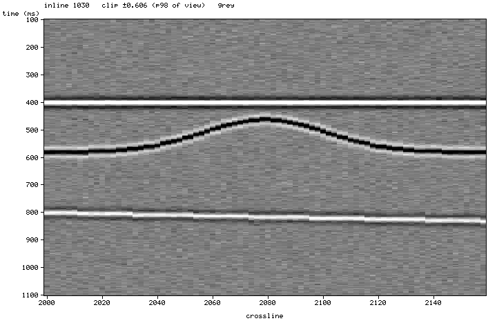
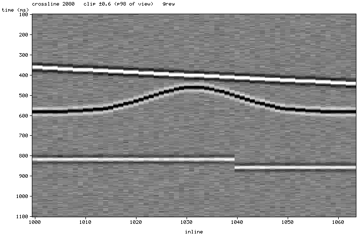
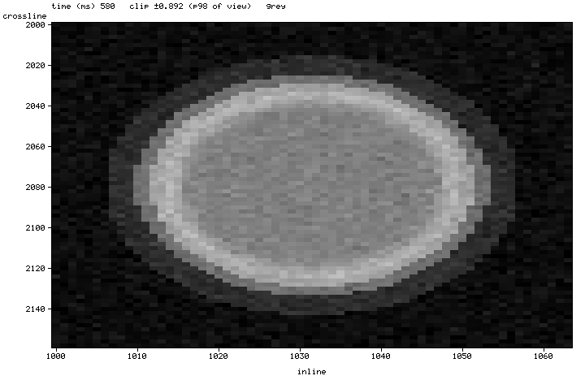

# Exploring a 3D post-stack volume

This example opens a 3D post-stack volume without reading its samples, reads what segyrs learned about its layout, selects inlines, crosslines and time slices by their labels, draws them, and decodes the trace headers and coordinate scalars by hand to check segyrs against the bytes. It then breaks the layout on purpose: shuffled traces, missing traces, keys at the wrong bytes, and a file with extra bytes at the end.

Everything on this page comes from one script, [`examples/explore_3d_volume.py`](https://github.com/cratongen/segyrs/blob/main/examples/explore_3d_volume.py). Run it from a checkout with `mise run example`. Each code block below is a verbatim part of that script, and each result block is verbatim output from it; `python/tests/test_examples.py` fails when either drifts. The script asserts every check the page describes, so a run that finishes is a run where they all held. It needs about 7 MB of scratch space, downloads nothing, and deletes its files at the end.

## Terms and conventions

A **SEG-Y** file stores seismic data as a 3200-byte **textual header** (40 cards of 80 characters), a 400-byte **binary header** (sample format, sample interval, sample count), then one **trace** after another. Each trace is a 240-byte **trace header** followed by its **samples**, the amplitudes recorded at a fixed interval down the trace. A **post-stack** volume holds one trace per surface position, after the data recorded at different source-receiver offsets have been summed.

The surface positions sit on a grid of **inlines** and **crosslines**, the two survey axes. Each trace header carries the inline and crossline number of its position, and those numbers are the **labels** you select by. A **position** is the 0-based index along an axis, whatever the labels are.

| Convention | On this page |
| --- | --- |
| Dimension names | `inline`, `crossline`, `time` on a regular grid; `trace`, `time` otherwise |
| Time labels | Two-way time in **microseconds**, integers: `400_000` is 400 ms. Pictures label the axis in milliseconds |
| Label slices | Inclusive at both ends: `slice(1020, 1040)` keeps 21 inlines |
| Byte positions | 1-based, as the SEG-Y standard numbers them. Bytes 189-192 of a trace header are `raw[188:192]` in Python |
| Byte order | Big-endian, the SEG-Y default. segyrs decodes to the machine's order |
| Coordinates | `cdp_x` and `cdp_y` in metres after the coordinate scalar (`scalco`) is applied |

## A small volume with known geology

The test files in `test-data/` are too small to show a section, and the large surveys this library is built for do not belong in a documentation build. The script makes its own volume from a fixed seed, so you know what each picture should show before you draw it.

The grid has 64 inlines numbered 1000 to 1063 and 80 crosslines numbered 2000 to 2158 in steps of 2. Each trace has 251 samples every 4 ms, starting at 100 ms. The start of a trace is the **delay recording time**, trace-header bytes 109-110, in milliseconds.

```python
rng = np.random.default_rng(20261120)
inlines = np.arange(1000, 1064)
crosslines = np.arange(2000, 2160, 2)
n_samples, dt_us, delay_ms = 251, 4000, 100
t = delay_ms / 1000 + np.arange(n_samples) * dt_us / 1e6
```

Three reflectors make the geology. The first dips 80 ms across the inlines. The second is a dome centred near inline 1031 and crossline 2079, rising 120 ms above its flanks, with a negative reflection coefficient. The third dips 30 ms across the crosslines and drops 40 ms at a fault between inlines 1039 and 1040. Each **reflection coefficient** becomes a spike at its time, the spikes are convolved with a 25 Hz Ricker wavelet, and seeded noise with a standard deviation of 0.05 goes on top.

```python
il, xl = np.meshgrid(inlines, crosslines, indexing="ij")
u, v = (il - 1000) / 63, (xl - 2000) / 158
horizons = [
    (0.36 + 0.08 * u, 1.0),
    (0.58 - 0.12 * np.exp(-((u - 0.5) ** 2 + (v - 0.5) ** 2) / 0.04), -0.8),
    (0.80 + 0.03 * v + 0.04 * (il >= 1040), 0.6),
]
reflectivity = np.zeros((*il.shape, n_samples))
for twt, rc in horizons:
    k = np.rint((twt - t[0]) * 1e6 / dt_us).astype(int)
    np.put_along_axis(reflectivity, k[..., None], rc, axis=-1)

tw = np.arange(-20, 21) * dt_us / 1e6
ricker = (1 - 2 * (np.pi * 25 * tw) ** 2) * np.exp(-((np.pi * 25 * tw) ** 2))
cube = np.apply_along_axis(np.convolve, -1, reflectivity, ricker, mode="same")
cube = (cube + 0.05 * rng.standard_normal(cube.shape)).astype(np.float32)
```

Each trace also gets the map position of its **common depth point** (CDP), the surface point the stacked trace represents. The grid origin is at (500 000, 6 000 000) m, the grid is rotated 30 degrees, inlines are 25 m apart, and adjacent crosslines are 12.5 m apart. The coordinates are rounded to centimetres because the file stores them as integers.

```python
azimuth = np.deg2rad(30)
along_il, along_xl = (il - 1000) * 25.0, (xl - 2000) / 2 * 12.5
cdp_x = np.round(500_000 + along_il * np.cos(azimuth) - along_xl * np.sin(azimuth), 2)
cdp_y = np.round(6_000_000 + along_il * np.sin(azimuth) + along_xl * np.cos(azimuth), 2)
```

`segyrs.create` writes the cube in **IBM float**, the 32-bit hexadecimal floating-point format of SEG-Y rev 0, which many delivered files still use. The inline and crossline numbers go to bytes 189 and 193, the standard positions since SEG-Y rev 1. `scalco` is the **coordinate scalar** at bytes 71-72: a negative value divides the stored integer, a positive value multiplies it, so `-100` stores centimetres.

```python
path = workdir / "survey3d.sgy"
segyrs.create(
    path,
    cube,
    sample_format="ibm_float32",
    sample_interval_us=dt_us,
    inline=inlines,
    crossline=crosslines,
    headers={"cdp_x": cdp_x, "cdp_y": cdp_y, "scalco": -100, "delay": delay_ms},
    text=[
        "C 1 SYNTHETIC 3D POST-STACK VOLUME, SEED 20261120. NOT FIELD DATA.",
        "C 2 INLINE BYTE 189, CROSSLINE BYTE 193, BOTH INT32.",
        "C 3 CDP X BYTE 181, CDP Y BYTE 185, METRES, SCALCO -100 (CENTIMETRES).",
        "C 4 TWO-WAY TIME IN MS, DELAY 100 MS, SAMPLE INTERVAL 4 MS.",
    ],
)
print(f"{path.stat().st_size} bytes")
```

```text
6372880 bytes
```

That size is the 3600 bytes of file header plus 5120 traces of 240 + 251 × 4 bytes. segyrs checks that sum when it opens a file.

## Open lazily

`segyrs.open` reads the textual and binary headers and enough trace headers to learn the layout. It reads no samples.

```python
vol = segyrs.open(path)
print(vol)
print("traces read:", vol.traces_read)
assert vol.traces_read == 0
```

```text
<segyrs.Volume (inline: 64, crossline: 80, time: 251)> float32 ibm_float32, lazy, chunks of whole traces
  inline     1000 .. 1063
  crossline  2000 .. 2158
  time       100000 .. 1100000 us
  geometry   inline_major
traces read: 0
```

The volume has three named dimensions with their label ranges. The samples come back as `float32`, decoded from `ibm_float32` on disk. The time axis starts at the 100 ms delay, written as 100 000 µs. `traces_read` counts the traces whose samples segyrs has read so far.

## Read the geometry report

`vol.geometry` is what open learned about the layout of the traces.

```python
print(vol.geometry)
print("source:", vol.geometry.source)
print("crossline labels:", vol.geometry.crosslines[:4], "...", vol.geometry.crosslines[-1])
for key in ("sample_format", "revision", "sample_interval_us", "measurement_system"):
    print(f"{key}: {vol.attrs[key]!r}")
for card in vol.attrs["textual_header"][:4]:
    print(card.rstrip())
```

```text
Geometry(kind='inline_major', axes=('inline', 'crossline'), inlines=64, crosslines=80, offsets=1, source='assumed', bytes=(inline=189, crossline=193, offset=37))
source: assumed
crossline labels: [2000 2002 2004 2006] ... 2158
sample_format: 'ibm_float32'
revision: '1'
sample_interval_us: 4000
measurement_system: None
C 1 SYNTHETIC 3D POST-STACK VOLUME, SEED 20261120. NOT FIELD DATA.
C 2 INLINE BYTE 189, CROSSLINE BYTE 193, BOTH INT32.
C 3 CDP X BYTE 181, CDP Y BYTE 185, METRES, SCALCO -100 (CENTIMETRES).
C 4 TWO-WAY TIME IN MS, DELAY 100 MS, SAMPLE INTERVAL 4 MS.
```

Read the report field by field:

- `kind='inline_major'`: the traces form a complete grid and are **sorted** inline by inline, crossline varying fastest within each inline. `axes` lists the grid axes slowest first.
- `inlines=64, crosslines=80, offsets=1`: the number of distinct labels on each axis. One offset means post-stack.
- `bytes=(inline=189, crossline=193, offset=37)`: the trace-header bytes the keys came from. If these are wrong for your file, every other field is wrong too ([What can go wrong](#what-can-go-wrong)).
- `source='assumed'`: for a local file of more than 4096 traces, open reads a sample of the trace headers, finds a grid whose labels step by a constant, and assumes the rest. Every read checks the headers of the traces it touches, and a trace that contradicts the grid raises `GeometryAssumptionError`. Open with `scan="full"` to read every header up front; the report then says `source='scan'`.

The crossline labels step by 2, so crossline 2001 does not exist. `measurement_system` is `None` because binary-header bytes 3255-3256 hold 0 in this file: the binary header does not say whether coordinates are metres or feet. The textual header does, in card C 3. Many delivered files are like this, so read the cards before you trust a unit.

## Select by label

`sel` selects by label and `isel` by position. Both return a new lazy `Volume`; `numpy()` reads the samples.

```python
section = vol.sel(inline=1030)
print(section.dims, section.shape)
print("traces read:", vol.traces_read)
data = section.numpy()
print("traces read:", section.traces_read)
print(data.dtype, data.shape)
```

```text
('crossline', 'time') (80, 251)
traces read: 0
traces read: 80
float32 (80, 251)
```

Selecting one inline drops the `inline` dimension. Nothing is read until `numpy()`, and then only the 80 traces of that inline.

IBM float keeps a 24-bit fraction, but its exponent counts powers of 16, so up to three leading bits of the fraction can be zero. Converting a `float32` to IBM float therefore keeps at least 21 significant bits, and the error of one sample is below 2^-20 times its value. The check below holds the inline to that bound against the cube the script wrote, and checks that label 1030 and position 30 are the same inline:

```python
ibm_tolerance = 2.0**-20 * np.abs(cube).max()
assert np.abs(data - cube[30]).max() <= ibm_tolerance
assert np.array_equal(data, vol.isel(inline=30).numpy())
```

A crossline and a time slice work the same way. A **time slice** is the map of amplitudes at one time. Time labels are microseconds, so 400 ms is `400_000`, the 76th sample (position 75) after the 100 ms delay.

```python
xline = vol.sel(crossline=2080)
tslice = vol.sel(time=400_000)
print(xline.dims, xline.shape)
print(tslice.dims, tslice.shape)
assert np.abs(xline.numpy() - cube[:, 40]).max() <= ibm_tolerance
assert np.abs(tslice.numpy() - cube[:, :, 75]).max() <= ibm_tolerance
```

```text
('inline', 'time') (64, 251)
('inline', 'crossline') (64, 80)
```

Label slices include both ends, so a window from inline 1020 to 1040 and from 300 ms to 700 ms has 21 inlines and 101 samples. Fixing the crossline drops that dimension. `coords["time"]` is the time label of every sample: `delay + i × interval`, computed from the header integers.

```python
window = vol.sel(inline=slice(1020, 1040), crossline=2080, time=slice(300_000, 700_000))
print(window.dims, window.shape)
print(vol.coords["time"][:3], "...", vol.coords["time"][-1])
assert np.abs(window.numpy() - cube[20:41, 40, 50:151]).max() <= ibm_tolerance
```

```text
('inline', 'time') (21, 101)
[100000 104000 108000] ... 1100000
```

## Draw sections and a time slice

`plot()` draws a 2D selection in Rust and returns a `Picture`. In a notebook the picture shows itself; here the script saves PNG files. The default colour map is `grey`: positive amplitudes are light, negative amplitudes dark. Without `vmin` and `vmax`, the clip is the 98th percentile of the absolute amplitude of the drawn view, the same on both sides of zero.

```python
pic = vol.sel(inline=1030).plot(width=640, height=400)
pic.save(figures / "inline-1030.png")
print(pic.text)
```

```text
segyrs section: inline 1030 | x crossline (80 positions), y time (ms) (251 positions) | grid 80x251 | clip ±0.606 (p98 of drawn view) | grey
```



Inline 1030 crosses the middle of the dome. The first reflector is flat along this line because it dips only across the inlines. The dark reflector rises from about 580 ms to 460 ms over the dome crest and comes back down. The deep reflector dips 30 ms from crossline 2000 to 2158.

```python
vol.sel(crossline=2080).plot(width=640, height=400).save(figures / "crossline-2080.png")
```



Crossline 2080 runs across the inlines. The shallow reflector dips 80 ms from inline 1000 to 1063. The deep reflector steps down 40 ms between inlines 1039 and 1040: that is the fault.

```python
pic = vol.sel(time=580_000).plot(width=640, height=400)
pic.save(figures / "time-580ms.png")
print(pic.text)
```

```text
segyrs section: time (ms) 580 | x inline (64 positions), y crossline (80 positions) | grid 64x80 | clip ±0.892 (p98 of drawn view) | grey
```



At 580 ms the slice cuts the dark reflector where it is flat, away from the dome, so the corners are dark. Over the dome the reflector is shallower than 580 ms. The slice there cuts the light side lobes of the wavelet on the flanks, which draw a ring, and then only noise above the crest. The ring is the dome's contour at 580 ms.

## Trace headers and coordinate scalars

`vol.headers` holds every standard trace-header field as one numpy column per field, one entry per trace in file order. The values are the integers in the file, before any scalar.

```python
print(sorted(vol.headers)[:6], "...", len(vol.headers), "fields")
print("scalco:", np.unique(vol.headers["scalco"]))
print("cdp_x word, trace 0:", vol.headers["cdp_x"][0])
print("cdp_x metres, trace 0:", vol.coords["cdp_x"][0, 0])
```

```text
['alias_freq', 'alias_slope', 'cdp', 'cdp_x', 'cdp_y', 'coord_units'] ... 87 fields
scalco: [-100]
cdp_x word, trace 0: 50000000
cdp_x metres, trace 0: 500000.0
```

The header word holds 50 000 000. `scalco` is -100, so the coordinate is 50 000 000 / 100 = 500 000 m. `vol.coords["cdp_x"]` applies that rule and returns float64 metres with the shape of the grid, `(inline, crossline)`. The integer word stays beside it as `cdp_x_raw`. A positive scalar multiplies and a zero scalar means 1. Elevations follow the same rule with `scalel`, bytes 69-70. The amplitudes are never scaled.

To check segyrs against the file, read the 240 bytes of the first trace header and decode four words yourself. Each is a big-endian signed integer at the byte positions of the standard:

```python
raw = vol.header_bytes(0)
print(len(raw), "bytes")
print("bytes 71-72 (scalco):", int.from_bytes(raw[70:72], "big", signed=True))
print("bytes 181-184 (cdp_x):", int.from_bytes(raw[180:184], "big", signed=True))
print("bytes 189-192 (inline):", int.from_bytes(raw[188:192], "big", signed=True))
print("bytes 193-196 (crossline):", int.from_bytes(raw[192:196], "big", signed=True))
assert int.from_bytes(raw[188:192], "big", signed=True) == vol.headers["inline"][0] == 1000
```

```text
240 bytes
bytes 71-72 (scalco): -100
bytes 181-184 (cdp_x): 50000000
bytes 189-192 (inline): 1000
bytes 193-196 (crossline): 2000
```

The scaled coordinates give the bin size back. The distance between the first two inlines is the inline spacing, and the distance between the first two crosslines is the crossline spacing. Both match the grid the script built, and the scaled coordinates match the coordinates it wrote:

```python
x, y = vol.coords["cdp_x"], vol.coords["cdp_y"]
inline_spacing = np.hypot(x[1, 0] - x[0, 0], y[1, 0] - y[0, 0])
crossline_spacing = np.hypot(x[0, 1] - x[0, 0], y[0, 1] - y[0, 0])
print(f"inline spacing {inline_spacing:.2f} m, crossline spacing {crossline_spacing:.2f} m")
assert np.allclose(x, cdp_x) and np.allclose(y, cdp_y)
assert np.allclose(vol.coords["cdp_x_raw"] / 100, vol.coords["cdp_x"])
```

```text
inline spacing 25.00 m, crossline spacing 12.50 m
```

On this assumed-grid file, the first read of `headers` or `coords` reads every trace header once and checks it against the grid.

## Unsorted and sparse geometry

A file does not have to store its traces in grid order, or have a trace at every grid position. segyrs opens both kinds without failing and tells you which kind it found.

An **unsorted** file has a trace at every position but in no inline or crossline order. The script writes the same traces in a random order:

```python
order = rng.permutation(il.size)
traces = cube.reshape(-1, n_samples)[order]
unsorted_path = workdir / "unsorted.sgy"
segyrs.create(
    unsorted_path,
    traces,
    sample_format="ibm_float32",
    sample_interval_us=dt_us,
    inline=il.ravel()[order],
    crossline=xl.ravel()[order],
    headers={"delay": delay_ms},
)
messy = segyrs.open(unsorted_path)
print(messy)
print(messy.geometry)
```

```text
<segyrs.Volume (trace: 5120, time: 251)> float32 ibm_float32, lazy, chunks of whole traces
  trace      0 .. 5119
  time       100000 .. 1100000 us
  geometry   unsorted
Geometry(kind='unsorted', axes=(), inlines=64, crosslines=80, offsets=1, bytes=(inline=189, crossline=193, offset=37))
```

The volume keeps the file's order: its dimensions are `(trace, time)`, and `inline` and `crossline` become coordinates along `trace`. segyrs does not reorder the traces in memory, and it does not invent a grid the file does not have.

Open builds an index from `(inline, crossline)` to file trace, so selecting one position still reads one trace. Selecting one inline filters the traces and keeps them in file order: the crosslines of inline 1030 come back as they sit in the file, not sorted.

```python
trace = messy.sel(inline=1030, crossline=2080)
print(trace.dims, trace.shape, "file trace", trace.coords["trace"])
assert np.abs(trace.numpy()[0] - cube[30, 40]).max() <= ibm_tolerance
line = messy.sel(inline=1030)
print(line.dims, line.shape)
print(line.coords["crossline"][:5], line.coords["trace"][:5])
```

```text
('trace', 'time') (1, 251) file trace [4999]
('trace', 'time') (80, 251)
[2124 2146 2024 2028 2022] [ 58  82 125 140 179]
```

To work on the grid, sort the file once. `resort` writes a new file sorted by the keys you name, inside a memory budget (by default half the available RAM; above it the sort spills to disk). The summary says how it ran. The sorted file opens as a grid, and its inline 1030 matches the original cube:

```python
summary = messy.resort(workdir / "sorted.sgy", by=["inline", "crossline"])
print(summary)
tidy = segyrs.open(workdir / "sorted.sgy")
print(tidy.geometry)
assert np.abs(tidy.sel(inline=1030).numpy() - cube[30]).max() <= ibm_tolerance
```

```text
{'already_sorted': False, 'strategy': 'memory', 'runs': 0, 'spilled_bytes': 0}
Geometry(kind='inline_major', axes=('inline', 'crossline'), inlines=64, crosslines=80, offsets=1, source='assumed', bytes=(inline=189, crossline=193, offset=37))
```

A **sparse** file is sorted but has positions with no trace, as in a survey with gaps from obstacles or an irregular outline. The script drops three traces:

```python
keep = np.ones(il.size, bool)
keep[[100, 2500, 5000]] = False
sparse_path = workdir / "sparse.sgy"
segyrs.create(
    sparse_path,
    cube.reshape(-1, n_samples)[keep],
    sample_format="ibm_float32",
    sample_interval_us=dt_us,
    inline=il.ravel()[keep],
    crossline=xl.ravel()[keep],
)
holes = segyrs.open(sparse_path)
print(holes.geometry)
print(holes.geometry.missing_pairs)
dense, mask, coords = holes.to_regular(fill=0)
print(dense.shape, mask.shape, int((~mask).sum()), "empty slots")
assert not mask[1, 20] and np.all(dense[1, 20] == 0)
assert np.abs(dense[mask] - cube[mask]).max() <= ibm_tolerance
```

```text
Geometry(kind='sparse', axes=(), inlines=64, crosslines=80, offsets=1, missing_pairs=3, bytes=(inline=189, crossline=193, offset=37))
[[1001 2040]
 [1031 2040]
 [1062 2080]]
(64, 80, 251) (64, 80) 3 empty slots
```

`missing_pairs` names the empty positions. `to_regular` builds the dense grid only when you ask, fills the empty positions with `fill`, and returns a mask that is false there, so a zero you inserted never passes for a recorded zero amplitude. It refuses with `BudgetError` when the dense array would not fit its memory budget; `to_regular("dense.sgy")` streams the same grid to a file instead.

## What can go wrong

Every message below is the real one, printed by the script through this helper:

```python
def show_error(call):
    try:
        call()
    except Exception as err:
        print(f"{type(err).__name__}: {err}")
    else:
        raise AssertionError("expected an error")
```

**A label that does not exist.** Crossline labels step by 2, and time labels are microseconds on the 4 ms sample grid. The message gives the range and the step. A misspelt dimension name is a `ValueError` that suggests the right one. `method="nearest"` picks the closest label when you want that; on a tie it takes the lower one.

```python
show_error(lambda: vol.sel(crossline=2081))
show_error(lambda: vol.sel(time=401_000))
show_error(lambda: vol.sel(iline=1030))
print(vol.sel(crossline=2081, method="nearest").coords["crossline"])
```

```text
KeyError: 'crossline=2081 is not a label; the 80 crossline labels run 2000..2158 step 2'
KeyError: 'time=401000 is not a label; the 251 time labels run 100000..1100000 step 4000'
ValueError: 'iline' is not a dimension (dims ('inline', 'crossline', 'time')); did you mean 'inline'?
2080
```

**A grid dimension on a file that is not a grid.** On the unsorted volume, `inline` is a coordinate, not a dimension, so there is no inline position to take. Select by label with `sel(inline=...)`, or `resort` the file.

```python
show_error(lambda: messy.isel(inline=0))
```

```text
GeometryError: 'inline' is not a dimension of this Volume (dims ('trace', 'time')); geometry kind is 'unsorted'
```

**Keys at other bytes.** Older files, and some processing systems, store the inline and crossline numbers somewhere other than bytes 189 and 193. Here the script writes them to bytes 9 (field record) and 21 (CDP number) and leaves 189 and 193 at zero. Opened with the defaults, every trace has the same key 0, and segyrs reports an `unstructured` file with no grid. It does not raise, because a trace sequence with no grid is a valid SEG-Y file. Pass the right bytes and the grid comes back. The textual header is the usual place to find them.

```python
moved = workdir / "moved-keys.sgy"
segyrs.create(
    moved,
    traces,
    sample_format="ibm_float32",
    sample_interval_us=dt_us,
    headers={"field_record": il.ravel()[order], "cdp": xl.ravel()[order]},
)
print(segyrs.open(moved).geometry)
print(segyrs.open(moved, inline_byte=9, crossline_byte=21).geometry)
```

```text
Geometry(kind='unstructured', axes=(), inlines=0, crosslines=0, offsets=0, bytes=(inline=189, crossline=193, offset=37))
Geometry(kind='unsorted', axes=(), inlines=64, crosslines=80, offsets=1, bytes=(inline=9, crossline=21, offset=37))
```

An `unstructured` report on a file you expect to be a 3D volume almost always means the key bytes are wrong. Decode a few candidate words from `vol.header_bytes(0)`, as in [Trace headers and coordinate scalars](#trace-headers-and-coordinate-scalars), before you reach for anything else.

**Two traces at one position.** A post-stack grid has one trace per inline and crossline pair. A duplicate usually means the keys are at the wrong bytes, or that the file is pre-stack and the offset key is wrong. segyrs refuses to open it rather than choose one of the two traces.

```python
twice = workdir / "duplicate.sgy"
segyrs.create(
    twice,
    cube.reshape(-1, n_samples)[:3],
    sample_format="ibm_float32",
    sample_interval_us=dt_us,
    inline=[1000, 1000, 1000],
    crossline=[2000, 2002, 2000],
)
show_error(lambda: segyrs.open(twice))
```

```text
DuplicateKey: duplicate key inline=1000 crossline=2000
```

**Bytes after the last trace.** A tape copy or a transfer sometimes leaves padding at the end of a file. segyrs cannot tell padding from a wrong trace length, so it refuses the file and gives both lengths. When you know the extra bytes are padding, cut a copy to the expected length and open that.

```python
padded = workdir / "padded.sgy"
shutil.copyfile(path, padded)
with open(padded, "ab") as f:
    f.write(bytes(100))
show_error(lambda: segyrs.open(padded))
os.truncate(padded, path.stat().st_size)
assert segyrs.open(padded).shape == vol.shape
```

```text
SampleCountMismatch: sample count mismatch: file_len=6372980 expected=6372880 remainder=100
```

The [user guide](../user-guide.md#errors) lists every error class and when it is raised.
