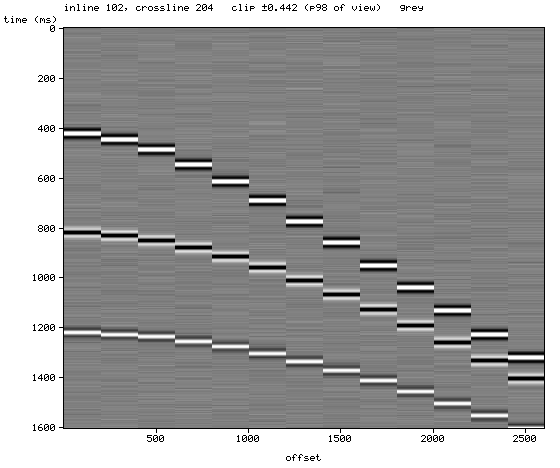
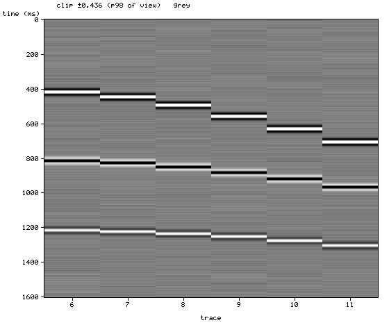
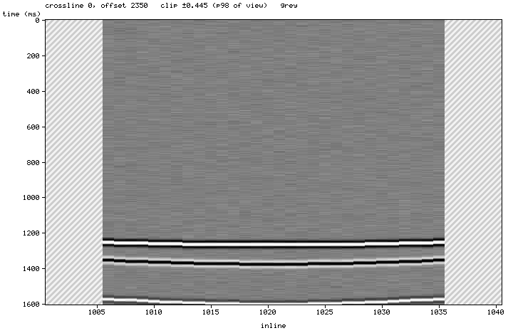
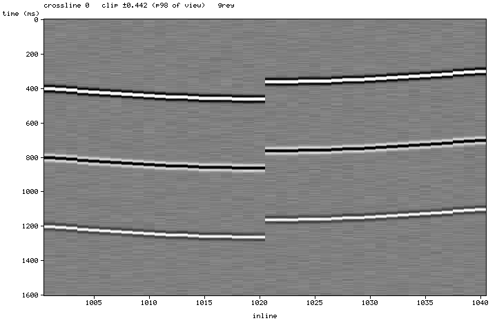
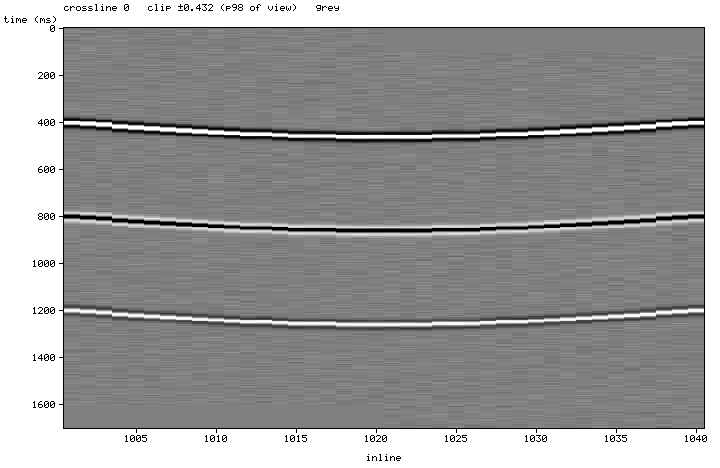

# Pre-stack gathers and 2D lines

This example works through the files a processing geophysicist receives besides a 3D stack: pre-stack gathers with a constant number of traces, a 2D line whose gathers vary in size, a stacked 2D line whose traces start at different times, and the same amplitudes stored in eight different sample formats. It ends with a set of damaged and mislabelled files, the error segyrs raises for each, and what each error tells you to check.

Everything on this page comes from one script, [`examples/prestack_and_2d.py`](https://github.com/cratongen/segyrs/blob/main/examples/prestack_and_2d.py). Run it from a checkout with `mise run example`. Each code block below is a verbatim part of that script, and each result block is verbatim output from it; `python/tests/test_examples.py` fails when either drifts. The script asserts every check the page describes, so a run that finishes is a run where they all held. It writes a few megabytes of scratch files, reads a few small files from `test-data/`, downloads nothing, and deletes its files at the end.

[Exploring a 3D volume](explore-3d-volume.md) introduces the textual, binary and trace headers, labels and positions, and the geometry report. This page assumes them.

## Terms and conventions

A **trace** is the record of one source and one receiver: a 240-byte trace header and then its **samples**, the amplitudes at a fixed time interval. The **offset** is the distance from the source to the receiver. The **common depth point** (CDP), also called the common midpoint, is the surface point halfway between them. A **gather** is the set of traces that share one key; a **CDP gather** holds every trace whose midpoint is one CDP, at its different offsets. The number of traces in a CDP gather is its **fold**. Data that still holds one trace per source and receiver pair is **pre-stack**. Summing each CDP gather, after correcting for the offset, gives one **stacked** (post-stack) trace per CDP.

A **3D** survey places the CDPs on a grid of inlines and crosslines. A **2D** line places them along one line, numbered by CDP alone.

| Convention | On this page |
| --- | --- |
| Dimension names | `inline`, `crossline`, `offset`, `time` on a regular grid; `trace`, `time` otherwise. A 2D line uses `inline` for its CDP number ([below](#a-2d-line-with-varying-fold)) |
| Time labels | Two-way time in **microseconds**, integers: `400_000` is 400 ms. Pictures label the axis in milliseconds |
| Offsets | Metres, as the integer in trace-header bytes 37-40 |
| Byte positions | 1-based, as the SEG-Y standard numbers them. Bytes 37-40 of a trace header are `raw[36:40]` in Python |
| Byte order | Big-endian unless the file says otherwise. segyrs decodes to the machine's order |
| Coordinates | Metres after the coordinate scalar `scalco` (bytes 71-72): a negative value divides the stored integer, a positive value multiplies it |

## A model with known moveout

The script makes its own gathers from a fixed seed, so the time of every event is known before the file is read. Three flat reflectors sit at zero-offset two-way times `t0` of 400, 800 and 1200 ms. On a trace at offset `x`, a reflector arrives at the hyperbolic **moveout** time `sqrt(t0² + (x / v_rms)²)`, where `v_rms` is the root-mean-square velocity down to that reflector. Each reflection coefficient becomes a spike at its time, the spikes are convolved with a 25 Hz Ricker wavelet, and seeded noise with a standard deviation of 0.02 goes on top. Every trace has 401 samples every 4 ms.

```python
rng = np.random.default_rng(20261120)
n_samples, dt_us = 401, 4000
events = [(0.40, 2000.0, 1.0), (0.80, 2200.0, -0.7), (1.20, 2400.0, 0.5)]

tw = np.arange(-20, 21) * dt_us / 1e6
ricker = (1 - 2 * (np.pi * 25 * tw) ** 2) * np.exp(-((np.pi * 25 * tw) ** 2))


def synthetic(t0_shift, offset, delay_s=0.0):
    t0s, xs, delays = np.broadcast_arrays(t0_shift, offset, delay_s)
    reflectivity = np.zeros((*t0s.shape, n_samples))
    for t0, v_rms, rc in events:
        twt = np.sqrt((t0 + t0s) ** 2 + (xs / v_rms) ** 2)
        k = np.rint((twt - delays) * 1e6 / dt_us).astype(int)
        hit = np.nonzero((k >= 0) & (k < n_samples))
        reflectivity[(*hit, k[hit])] = rc
    traces = np.apply_along_axis(np.convolve, -1, reflectivity, ricker, mode="same")
    return (traces + 0.02 * rng.standard_normal(traces.shape)).astype(np.float32)
```

`t0_shift` moves the reflectors down per trace, which gives them dip or structure. `delay_s` is the time of a trace's first sample, used [later](#traces-that-start-at-different-times). The checks on this page find an event with `pick`: the time, in microseconds, of the largest absolute amplitude within 20 ms of where the model puts it.

```python
def pick(trace, twt):
    centre = round(twt * 1e6 / dt_us)
    lo, hi = max(centre - 5, 0), min(centre + 6, len(trace))
    return (lo + int(np.argmax(np.abs(trace[lo:hi])))) * dt_us
```

## 3D gathers with constant fold

The first file holds a CDP gather at every position of a small 3D grid: 6 inlines (100 to 105), 8 crosslines (200 to 207), and the same 13 offsets, 100 m to 2500 m in steps of 200 m, at every position. The reflectors dip 4 ms per inline and 2 ms per crossline.

```python
inlines = np.arange(100, 106)
crosslines = np.arange(200, 208)
offsets = np.arange(100, 2600, 200)
il, xl = np.meshgrid(inlines, crosslines, indexing="ij")
dip = 0.004 * (il - 100) + 0.002 * (xl - 200)
cube = synthetic(dip[..., None], offsets)
print(cube.shape, cube.dtype)
```

```text
(6, 8, 13, 401) float32
```

`segyrs.create` takes a 4D array `(inline, crossline, offset, time)` and writes one trace per inline, crossline and offset, offset varying fastest. The offset of each trace goes to bytes 37-40, the standard position. The samples are stored as 32-bit **IEEE float** (format code 5).

```python
path = workdir / "prestack3d.sgy"
segyrs.create(
    path,
    cube,
    sample_format="ieee_float32",
    sample_interval_us=dt_us,
    inline=inlines,
    crossline=crosslines,
    offset=offsets,
    text=[
        "C 1 SYNTHETIC 3D PRE-STACK CDP GATHERS, SEED 20261120. NOT FIELD DATA.",
        "C 2 INLINE BYTE 189, CROSSLINE BYTE 193, OFFSET BYTE 37 (METRES), ALL INT32.",
        "C 3 TWO-WAY TIME, SAMPLE INTERVAL 4 MS, 401 SAMPLES, NO DELAY.",
    ],
)
print(f"{path.stat().st_size} bytes")
```

```text
1154256 bytes
```

That is 3600 bytes of file header plus 624 traces of 240 + 401 × 4 bytes.

```python
gathers = segyrs.open(path)
print(gathers)
print(gathers.geometry)
```

```text
<segyrs.Volume (inline: 6, crossline: 8, offset: 13, time: 401)> float32 ieee_float32, lazy, chunks of whole traces
  inline     100 .. 105
  crossline  200 .. 207
  offset     100 .. 2500
  time       0 .. 1600000 us
  geometry   inline_major
Geometry(kind='inline_major', axes=('inline', 'crossline', 'offset'), inlines=6, crosslines=8, offsets=13, bytes=(inline=189, crossline=193, offset=37))
```

Every inline and crossline position has the same 13 offsets, so `offset` is a real dimension and the volume is 4D. `axes` lists the sort order of the file, slowest first: within each inline, each crossline, then the offsets of that gather.

Selecting one inline and one crossline gives one CDP gather, with dimensions `(offset, time)`:

```python
gather = gathers.sel(inline=102, crossline=204)
print(gather.dims, gather.shape)
print("offsets:", gather.coords["offset"])
data = gather.numpy()
assert np.array_equal(data, cube[2, 4])
```

```text
('offset', 'time') (13, 401)
offsets: [ 100  300  500  700  900 1100 1300 1500 1700 1900 2100 2300 2500]
```

IEEE float32 stores a float32 exactly, so the gather equals the array the script wrote, bit for bit. A stronger check is that the events sit where the moveout equation puts them. On this gather the reflectors are 2 × 4 + 4 × 2 = 16 ms below their `t0`:

```python
for t0, v_rms, _ in events:
    expected = np.sqrt((t0 + dip[2, 4]) ** 2 + (offsets / v_rms) ** 2)
    picked = np.array([pick(tr, twt) for tr, twt in zip(data, expected, strict=True)])
    error_ms = np.abs(picked - expected * 1e6).max() / 1000
    print(f"t0 {t0 * 1000:.0f} ms, v_rms {v_rms:.0f} m/s: largest pick error {error_ms:.1f} ms")
    assert error_ms <= dt_us / 1000
```

```text
t0 400 ms, v_rms 2000 m/s: largest pick error 1.8 ms
t0 800 ms, v_rms 2200 m/s: largest pick error 1.8 ms
t0 1200 ms, v_rms 2400 m/s: largest pick error 1.9 ms
```

Every pick is within half a sample (2 ms) of the exact moveout time, which is the best a pick on a 4 ms grid can do. An offset read from the wrong bytes, or a gather assembled from the wrong traces, would put the picks tens of milliseconds off.

```python
pic = gather.plot(width=480, height=400)
pic.save(figures / "gather-il102-xl204.png")
print(pic.text)
```

```text
segyrs section: inline 102, crossline 204 | x offset (13 positions), y time (ms) (401 positions) | grid 13x400 | clip ±0.442 (p98 of drawn view) | grey
```



The three events curve down with offset. The shallow event, with the lowest velocity, curves the most: from about 420 ms at 100 m to about 1320 ms at 2500 m. The middle event has a negative reflection coefficient, so its central lobe is dark.

A **common-offset section** keeps one offset and lets the position vary. Selecting an inline and an offset gives `(crossline, time)`:

```python
near = gathers.sel(inline=102, offset=100)
print(near.dims, near.shape)
assert np.array_equal(near.numpy(), cube[2, :, 0])
```

```text
('crossline', 'time') (8, 401)
```

## A 2D line with varying fold

Real gathers rarely have constant fold. At the ends of a 2D line the spread rolls on and off, so the first and last CDPs see only the near offsets. The second file is such a line: 40 CDPs numbered 1001 to 1040, 12.5 m apart, with up to 12 offsets from 150 m to 2350 m. The fold builds up by 2 per CDP from each end.

```python
cdps = np.arange(1001, 1041)
nominal = np.arange(150, 2550, 200)
fold = np.minimum(len(nominal), 2 + 2 * np.minimum(cdps - cdps[0], cdps[-1] - cdps))
print("fold per CDP:", fold[:8], "...", fold[-3:])

cdp = np.repeat(cdps, fold)
offset = np.concatenate([nominal[:n] for n in fold])
print(len(cdp), "traces")
```

```text
fold per CDP: [ 2  4  6  8 10 12 12 12] ... [6 4 2]
420 traces
```

The traces are **CDP sorted**: all traces of CDP 1001, then CDP 1002, and so on, each gather in increasing offset. A 2D line has no inline or crossline, so the CDP number goes to bytes 21-24, the CDP ensemble number of the standard. Each trace also gets the x coordinate of its source, its receiver (the **group**) and its CDP, in metres, stored as centimetres with `scalco` -100. The reflectors sag by up to 60 ms towards the middle of the line. The samples are stored as **IBM float** (format code 1), the hexadecimal floating-point format of SEG-Y rev 0.

```python
cdp_x = 300_000 + (cdp - 1001) * 12.5
source_x = cdp_x - offset / 2
group_x = cdp_x + offset / 2
structure = 0.06 * np.sin((cdps - 1001) / 39 * np.pi)
traces = synthetic(structure[cdp - 1001], offset)

line_path = workdir / "line2d-gathers.sgy"
segyrs.create(
    line_path,
    traces,
    sample_format="ibm_float32",
    sample_interval_us=dt_us,
    headers={
        "cdp": cdp,
        "offset": offset,
        "cdp_x": cdp_x,
        "cdp_y": 7_000_000.0,
        "source_x": source_x,
        "group_x": group_x,
        "source_y": 7_000_000.0,
        "group_y": 7_000_000.0,
        "scalco": -100,
    },
    text=[
        "C 1 SYNTHETIC 2D PRE-STACK LINE, CDP SORTED, SEED 20261120. NOT FIELD DATA.",
        "C 2 CDP BYTE 21, OFFSET BYTE 37 (METRES), BOTH INT32.",
        "C 3 COORDINATES IN METRES, SCALCO -100. CDP INTERVAL 12.5 M.",
    ],
)
```

### Tell segyrs where the CDP number is

Opened with the defaults, segyrs reads the keys at bytes 189 and 193. On this line they hold 0 on every trace, and the offsets alone do not make a grid:

```python
print(segyrs.open(line_path).geometry)
```

```text
Geometry(kind='unstructured', axes=(), inlines=0, crosslines=0, offsets=0, bytes=(inline=189, crossline=193, offset=37))
```

`unstructured` means segyrs found no grid and the file is a plain sequence of traces. It still opens and reads. segyrs has three trace keys, named `inline`, `crossline` and `offset`; on a 2D line, point the `inline` key at the CDP bytes with `inline_byte=21`. The crossline key then reads bytes 193-196, which hold 0 on every trace, so the line becomes one crossline numbered 0.

```python
line = segyrs.open(line_path, inline_byte=21)
print(line)
print(line.geometry)
print("missing pairs:", line.geometry.missing_pairs.shape)
```

```text
<segyrs.Volume (trace: 420, time: 401)> float32 ibm_float32, lazy, chunks of whole traces
  trace      0 .. 419
  time       0 .. 1600000 us
  geometry   sparse
Geometry(kind='sparse', axes=(), inlines=40, crosslines=1, offsets=12, bytes=(inline=21, crossline=193, offset=37))
missing pairs: (0, 2)
```

The report names 40 CDPs on the `inline` key, 1 crossline and 12 distinct offsets. The kind is `sparse` because 40 × 12 = 480 is more than the 420 traces: the box of every CDP at every offset has empty slots. A volume whose fold varies cannot have an `offset` dimension, so its dimensions are `(trace, time)` in file order, and the CDP number, the crossline and the offset are coordinates along `trace`.

`missing_pairs` lists empty `(inline, crossline)` positions only, and every CDP has at least two traces, so it is empty here. The empty slots are offsets, and the fold of each CDP is what tells you where they are. Count the traces per CDP label and compare with the fold the line was designed with:

```python
labels, counts = np.unique(line.coords["inline"], return_counts=True)
print("CDPs:", labels[0], "..", labels[-1], " fold:", counts[:8], "...", counts[-3:])
assert np.array_equal(labels, cdps) and np.array_equal(counts, fold)
```

```text
CDPs: 1001 .. 1040  fold: [ 2  4  6  8 10 12 12 12] ... [6 4 2]
```

On a field line, do this count first. A fold that does not match the acquisition geometry points to missing shots, a wrong key byte, or a file that is not sorted the way its textual header says.

### One gather

`sel(inline=1003)` filters the traces of CDP 1003 and keeps the `trace` dimension. The `trace` coordinate is the position of each trace in the file.

```python
edge = line.sel(inline=1003)
print(edge.dims, edge.shape)
print("offsets:", edge.coords["offset"], " file traces:", edge.coords["trace"])
ibm_tolerance = 2.0**-20 * np.abs(traces).max()
assert np.abs(edge.numpy() - traces[cdp == 1003]).max() <= ibm_tolerance
```

```text
('trace', 'time') (6, 401)
offsets: [ 150  350  550  750  950 1150]  file traces: [ 6  7  8  9 10 11]
```

CDP 1003 is the third from the end of the line, so it has 6 traces, the 6 nearest offsets. Converting a float32 to IBM float keeps at least 21 significant bits, so each sample read back is within 2^-20 of the largest amplitude of the file the script wrote ([Writing SEG-Y](../writing.md#ibm-float-encoding)).

```python
pic = line.sel(inline=1003).plot(width=480, height=400)
pic.save(figures / "gather-cdp1003.png")
print(pic.text)
```

```text
segyrs section: whole volume | x trace (6 positions), y time (ms) (401 positions) | grid 6x400 | clip ±0.436 (p98 of drawn view) | grey
```



On the `(trace, time)` layout the picture's horizontal axis is the file trace number, not the offset. The offsets of those traces are in `edge.coords["offset"]`.

### Check the offsets against the coordinates

The offset word and the source and receiver coordinates are written by different steps of a processing flow, and they do not always agree. On a 2D line the offset is the distance between source and receiver, and the CDP is halfway between them. `coords` applies `scalco` to every coordinate and keeps the stored integer beside it with a `_raw` name:

```python
sx, gx = line.coords["source_x"], line.coords["group_x"]
print("raw word, trace 0:", line.coords["source_x_raw"][0], " metres:", sx[0])
from_coordinates = np.abs(gx - sx)
print("largest offset disagreement:", np.abs(from_coordinates - line.coords["offset"]).max(), "m")
assert np.array_equal(from_coordinates, line.coords["offset"])
midpoint = (sx + gx) / 2
assert np.allclose(midpoint, line.coords["cdp_x"])
print("CDP interval:", np.unique(np.diff(np.unique(midpoint))), "m")
```

```text
raw word, trace 0: 29992500  metres: 299925.0
largest offset disagreement: 0.0 m
CDP interval: [12.5] m
```

The word 29 992 500 with `scalco` -100 is 299 925.00 m. The offsets in bytes 37-40 match the source-receiver distances exactly, the midpoints match the CDP coordinates, and the midpoints are 12.5 m apart. On a field line a crooked acquisition track makes the first check approximate; use the distance in both x and y there.

### Pad the gathers to a regular grid

Some processing steps want every gather at the same offsets. `to_regular` builds that grid when you ask for it: an array `(inline, crossline, offset, time)` with `fill` in the empty slots, and a mask that is false there.

```python
dense, mask, grid = line.to_regular(fill=0)
print(dense.shape, mask.shape, {k: len(v) for k, v in grid.items()})
print("live cells:", int(mask.sum()), " empty cells:", int((~mask).sum()))
assert np.array_equal(mask.sum(axis=(1, 2)), fold)
assert not mask[0, 0, -1] and np.all(dense[0, 0, -1] == 0)
```

```text
(40, 1, 12, 401) (40, 1, 12) {'inline': 40, 'crossline': 1, 'offset': 12, 'time': 401}
live cells: 420  empty cells: 60
```

The 420 live cells are the traces of the file, and the mask counts the designed fold at every CDP. Keep the mask with the array: a padded trace of zeros is not a recorded trace of zero amplitude.

With a path, `to_regular` streams the same grid to a new SEG-Y file instead of building it in memory, and writes each empty slot as a **dead trace**, a trace whose identification code (bytes 29-30) is 2. Open it with `dead_trace="trace_id"` to mark those traces dead. A common-offset section of the far offset shows which CDPs never reached it:

```python
summary = line.to_regular(workdir / "line2d-regular.sgy")
print(summary)
regular = segyrs.open(workdir / "line2d-regular.sgy", inline_byte=21, dead_trace="trace_id")
print(regular)
far = regular.sel(crossline=0, offset=2350)
print("live traces at 2350 m:", int(far.coords["trace_mask"].sum()), "of", far.shape[0])
pic = far.plot(width=640, height=400)
pic.save(figures / "line-offset-2350.png")
print(pic.text)
```

```text
{'cells': 480, 'filled': 60}
<segyrs.Volume (inline: 40, crossline: 1, offset: 12, time: 401)> float32 ibm_float32, lazy, chunks of whole traces
  inline     1001 .. 1040
  crossline  0 .. 0
  offset     150 .. 2350
  time       0 .. 1600000 us
  geometry   inline_major
live traces at 2350 m: 30 of 40
segyrs section: crossline 0, offset 2350 | x inline (40 positions), y time (ms) (401 positions) | grid 40x400 | clip ±0.445 (p98 of drawn view) | grey
```



The padded file has constant fold, so it opens as a 4D grid. The picture hatches the 10 dead traces, the five CDPs at each end. At 2350 m the moveout pushes the reflector that starts at 400 to 460 ms down to between 1240 and 1260 ms.

## Traces that start at different times

The time of a trace's first sample is its **delay recording time**, trace-header bytes 109-110, in milliseconds. Marine and land crews change it during a survey, for example to skip the water column in deep water, so the traces of one file do not always start at the same time.

The third file is a stacked 2D line: one zero-offset trace per CDP, built from the same model. The first 20 CDPs start at 0 ms. From CDP 1021 the delay is 100 ms, so those traces start 100 ms later and, with the same 401 samples, end 100 ms later.

```python
delay_ms = np.where(cdps <= 1020, 0, 100)
stack = synthetic(structure, 0.0, delay_s=delay_ms / 1000)
stack_path = workdir / "line2d-stack.sgy"
segyrs.create(
    stack_path,
    stack,
    sample_format="ibm_float32",
    sample_interval_us=dt_us,
    headers={
        "cdp": cdps,
        "cdp_x": 300_000 + (cdps - 1001) * 12.5,
        "scalco": -100,
        "delay": delay_ms,
    },
)
```

A stacked 2D line has one trace per CDP, so with `inline_byte=21` it opens as a grid of 40 inlines and 1 crossline.

```python
stacked = segyrs.open(stack_path, inline_byte=21)
print(stacked)
print("time axis:", stacked.coords["time"][:3], "...", stacked.coords["time"][-1])
delay = stacked.coords["delay"].ravel()
print("per-trace delay (us):", delay[18:23])
```

```text
<segyrs.Volume (inline: 40, crossline: 1, time: 401)> float32 ibm_float32, lazy, chunks of whole traces
  inline     1001 .. 1040
  crossline  0 .. 0
  time       0 .. 1600000 us
  geometry   inline_major
time axis: [   0 4000 8000] ... 1600000
per-trace delay (us): [     0      0 100000 100000 100000]
```

A volume has one time axis, and segyrs builds it from the delay of the **first trace**: `delay + i × interval`. When the delay varies, segyrs adds a `delay` coordinate with the delay of each trace, in microseconds, and leaves the samples where they are. It does not shift or resample them. So `time` is the time of sample `i` on the first trace only. `sel(time=...)` and `slice_horizon` select by sample position on that axis, so on this file they take the same sample index from every trace, which is 100 ms later in true time on the delayed traces.

Compare the strongest sample of CDP 1020 and CDP 1021, on either side of the change. The model puts the shallow reflector at 460 ms on both:

```python
first = 0.40 + structure
samples = stacked.sel(crossline=0).numpy()
for k in (19, 20):
    peak = int(np.argmax(np.abs(samples[k])))
    label = stacked.coords["time"][peak]
    true = delay[k] + peak * dt_us
    print(
        f"CDP {cdps[k]}: strongest sample {peak}, time label {label / 1000:.0f} ms,"
        f" delay + {peak} x 4 ms = {true / 1000:.0f} ms"
    )
    assert abs(true - first[k] * 1e6) <= dt_us
```

```text
CDP 1020: strongest sample 115, time label 460 ms, delay + 115 x 4 ms = 460 ms
CDP 1021: strongest sample 90, time label 360 ms, delay + 90 x 4 ms = 460 ms
```

The time label is right on CDP 1020 and 100 ms early on CDP 1021. The true time of sample `i` on trace `k` is `coords["delay"][k] + i × interval`. A picture of the file as stored shows the same step:

```python
pic = stacked.sel(crossline=0).plot(width=640, height=400)
pic.save(figures / "stack-as-stored.png")
print(pic.text)
```

```text
segyrs section: crossline 0 | x inline (40 positions), y time (ms) (401 positions) | grid 40x400 | clip ±0.442 (p98 of drawn view) | grey
```



The jump at CDP 1021 is the change of delay, not a fault. Before you interpret a section, check whether `coords` has a `delay` entry.

To put the line on one time axis, shift each trace down by its delay, in whole samples, into an array long enough for the latest trace, and write that with one delay. The shift has to be a whole number of samples; the script asserts it, because a fractional shift would need interpolation, which changes the samples.

```python
shift = (delay - delay.min()) // dt_us
assert np.all((delay - delay.min()) % dt_us == 0)
aligned = np.zeros((len(cdps), n_samples + shift.max()), np.float32)
for k, s in enumerate(shift):
    aligned[k, s : s + n_samples] = samples[k]
aligned_path = workdir / "line2d-aligned.sgy"
segyrs.create(
    aligned_path,
    aligned,
    sample_format="ibm_float32",
    sample_interval_us=dt_us,
    headers={"cdp": cdps, "delay": int(delay.min() // 1000)},
)
flat = segyrs.open(aligned_path, inline_byte=21)
print(flat)
assert "delay" not in flat.coords
level = flat.sel(crossline=0).numpy()
assert all(abs(pick(level[k], first[k]) - first[k] * 1e6) <= dt_us for k in range(len(cdps)))
flat.sel(crossline=0).plot(width=640, height=400).save(figures / "stack-aligned.png")
```

```text
<segyrs.Volume (inline: 40, crossline: 1, time: 426)> float32 ibm_float32, lazy, chunks of whole traces
  inline     1001 .. 1040
  crossline  0 .. 0
  time       0 .. 1700000 us
  geometry   inline_major
```



The aligned file has 426 samples, 0 to 1700 ms, and no `delay` coordinate, because every trace now starts at 0 ms. The shallow reflector is within one sample of its model time on all 40 traces. The zeros the script inserted (the top 100 ms of the delayed traces and the bottom 100 ms of the others) are not data; keep track of them as you would of the `to_regular` mask.

**The time scalar.** Bytes 215-216 hold a scalar for the delay, with the same rule as `scalco`. segyrs applies it. In `test-data/segyrs/delay-scalar.sgy` the delay word is 10000 and the scalar -10, so the first sample is at 10000 / 10 = 1000 ms:

```python
scaled = segyrs.open(test_data / "segyrs" / "delay-scalar.sgy")
print("bytes 109-110:", scaled.headers["delay"], " bytes 215-216:", scaled.headers["time_scalar"])
print("time axis starts at", scaled.coords["time"][0], "us")
assert scaled.coords["time"][0] == 1_000_000
```

```text
bytes 109-110: [10000]  bytes 215-216: [-10]
time axis starts at 1000000 us
```

Read without the scalar, the same file would start at 10 s.

## Sample formats

The binary header says how each sample is stored, in bytes 3225-3226: the **sample format code**. [Sample formats](../formats.md) lists all of them. segyrs decodes each format to the numpy type that holds it without loss, and never converts on its own: integers stay integers, and IBM float becomes float32.

`test-data/multiformats/` holds one F3 Netherlands survey cut (CC BY-SA 3.0, see `test-data/LICENSE.md`) written in every format code, in both byte orders. Its amplitudes are whole numbers. The IBM float file is the reference:

```python
ibm = segyrs.open(test_data / "multiformats" / "Format1msb.sgy")
reference = ibm.numpy()
print(ibm)
print("amplitude range:", reference.min(), reference.max())
for name in [
    "Format1lsb",
    "Format5msb",
    "Format6msb",
    "Format2msb",
    "Format3msb",
    "Format7msb",
    "Format9msb",
]:
    other = segyrs.open(test_data / "multiformats" / f"{name}.sgy")
    values = other.numpy()
    same = np.array_equal(values.astype(np.float64), reference.astype(np.float64))
    attrs = other.attrs
    print(
        f"{name:11} code {attrs['binary_format_code']:>2} {attrs['sample_format']:13}"
        f" {attrs['source_endian']:6} -> {values.dtype!s:7} same values: {same}"
    )
    assert same
```

```text
<segyrs.Volume (inline: 23, crossline: 18, time: 75)> float32 ibm_float32, lazy, chunks of whole traces
  inline     111 .. 133
  crossline  875 .. 892
  time       4000 .. 300000 us
  geometry   inline_major
amplitude range: -10239.0 10827.0
Format1lsb  code  1 ibm_float32   little -> float32 same values: True
Format5msb  code  5 ieee_float32  big    -> float32 same values: True
Format6msb  code  6 ieee_float64  big    -> float64 same values: True
Format2msb  code  2 int32         big    -> int32   same values: True
Format3msb  code  3 int16         big    -> int16   same values: True
Format7msb  code  7 int24         big    -> int32   same values: True
Format9msb  code  9 int64         big    -> int64   same values: True
```

Seven encodings, one set of values. The little-endian IBM file (`lsb`, least significant byte first) decodes to the same numbers as the big-endian one; `source_endian` records which byte order the file used. Format 7 is a 3-byte integer, so it comes back as int32. The amplitudes run from -10239 to 10827, which does not fit in 8 bits, so the int8 and uint8 files of the same set hold different numbers. segyrs decodes the bytes on disk and does not rescale them:

```python
for name in ["Format8msb", "Format16msb"]:
    other = segyrs.open(test_data / "multiformats" / f"{name}.sgy")
    values = other.numpy()
    print(
        f"{name:11} {other.attrs['sample_format']:6} -> {values.dtype},"
        f" range {values.min()} .. {values.max()}"
    )
```

```text
Format8msb  int8   -> int8, range -128 .. 127
Format16msb uint8  -> uint8, range 0 .. 255
```

### Decode one IBM float by hand

An IBM float is 32 bits: a sign bit, a 7-bit exponent that counts powers of 16 with a bias of 64, and a 24-bit fraction read as a number between 0 and 1. Its value is `sign × fraction × 16^(exponent - 64)`. To check segyrs against the bytes, read the first nonzero sample of trace 0 straight from the file. The sample count is in binary-header bytes 3221-3222, and the samples of trace 0 start after the 3600-byte file header and the 240-byte trace header:

```python
with open(test_data / "multiformats" / "Format1msb.sgy", "rb") as f:
    head = f.read(3600)
    n = int.from_bytes(head[3220:3222], "big")
    k = int(np.flatnonzero(reference.reshape(-1, n)[0])[0])
    f.seek(3600 + 240 + 4 * k)
    word = int.from_bytes(f.read(4), "big")
sign = -1.0 if word >> 31 else 1.0
exponent = (word >> 24) & 0x7F
fraction = (word & 0xFFFFFF) / 2**24
value = sign * fraction * 16.0 ** (exponent - 64)
print(
    f"trace 0 sample {k}: word 0x{word:08X}, sign {sign:+.0f}, exponent {exponent} - 64,"
    f" fraction 0x{word & 0xFFFFFF:06X} / 2^24 = {value}"
)
assert value == reference.reshape(-1, n)[0, k]
```

```text
trace 0 sample 19: word 0xC3A32000, sign -1, exponent 67 - 64, fraction 0xA32000 / 2^24 = -2610.0
```

0xA32000 / 2^24 is 0.6372..., and 0.6372... × 16³ = 2610. The hand decode and segyrs agree exactly. A 24-bit fraction always fits in the 24-bit significand of a float32, so decoding IBM to float32 is exact for every value in the float32 range.

### Convert on purpose

A file written by segyrs keeps its source format unless you name another one. `sample_format=` is the conversion. IBM to IEEE float32 loses nothing, and the script checks every sample:

```python
as_ieee = workdir / "f3-ieee.sgy"
ibm.to_segy(as_ieee, sample_format="ieee_float32")
converted = segyrs.open(as_ieee)
print(converted.attrs["sample_format"], converted.attrs["binary_format_code"])
assert np.array_equal(converted.numpy(), reference)
```

```text
ieee_float32 5
```

The reverse direction, float to IBM, can round; [Writing SEG-Y](../writing.md#ibm-float-encoding) gives the rule. A conversion to an integer format that would change a value is refused ([below](#what-can-go-wrong)).

## What can go wrong

The checks below are the ones to run on a file you do not trust, in roughly the order to run them. Every message is the real one, printed by the script through this helper:

```python
def show_error(call):
    try:
        call()
    except Exception as err:
        print(f"{type(err).__name__}: {err}")
    else:
        raise AssertionError("expected an error")
```

Every class is a subclass of `segyrs.SegyrsError`; the [user guide](../user-guide.md#errors) lists them all.

**Start with `validate`.** It checks the structure of the whole file without decoding any samples: the format code, the textual blocks, that the file length is the headers plus whole traces, and the sample count in every trace header. It returns the layout, or raises `ValidationError` with every problem it found.

```python
print(segyrs.validate(path))
show_error(lambda: segyrs.validate(test_data / "f3.sgy"))
print(segyrs.open(test_data / "f3.sgy").shape)
```

```text
{'revision': '1', 'sample_format': 'ieee_float32', 'binary_format_code': 5, 'endian': 'big', 'n_traces': 624, 'n_samples': 401, 'sample_interval_us': 4000, 'extended_textual_blocks': 0, 'extra_trace_header_blocks': 0, 'data_start': 3600}
ValidationError: invalid SEG-Y: 414 trace headers disagree with the binary sample count 75; first is trace 0 with 462
(23, 18, 75)
```

`f3.sgy` was cut from 462 samples to 75, and its trace headers still say 462. The binary header and the file length agree on 75, so the file opens and reads; `validate` tells you that some other program may not accept it.

**Not a SEG-Y file.** A Seismic Unix file has trace headers but no 3600-byte file header. segyrs recognises it and says so:

```python
show_error(lambda: segyrs.open(test_data / "small.su"))
```

```text
NotSegyError: not a SEG-Y file: it looks like Seismic Unix (SU): 25 traces of a 240-byte header and 50 float32 samples, with no 3600-byte SEG-Y file header; convert it to SEG-Y first (for example with Seismic Unix segywrite)
```

**A file cut off.** A transfer that stopped early leaves a file shorter than its headers declare. Here the file ends inside the file header:

```python
cut = workdir / "cut.sgy"
shutil.copyfile(path, cut)
os.truncate(cut, 3000)
show_error(lambda: segyrs.open(cut))
```

```text
TruncatedError: truncated SEG-Y: file has 3000 bytes, need at least 3600 for the 3200-byte textual and 400-byte binary file header; the file is cut off or is not SEG-Y
```

**A length that is not whole traces.** `broken.sgy` from the segyio test set ends partway through a trace. segyrs compares the file length with the headers plus whole traces and gives the three numbers. The same error covers padding after the last trace ([Exploring a 3D volume](explore-3d-volume.md#what-can-go-wrong)) and a wrong sample count in the binary header.

```python
show_error(lambda: segyrs.open(test_data / "broken.sgy"))
```

```text
SampleCountMismatch: sample count mismatch: file_len=10836 expected=10768 remainder=68
```

**Trace headers that disagree with the binary header.** In `decrement.sgy` every trace-header field is at its limit, including the sample count at bytes 115-116. The binary header says 4 samples per trace, the first trace header says 65496. segyrs does not guess which is right:

```python
show_error(lambda: segyrs.open(test_data / "decrement.sgy"))
```

```text
NonUniformTraceLength: non-uniform trace length: trace 0 binary_ns=4 trace_ns=65496
```

**A format code segyrs does not know.** Codes 13 and 14 are unassigned in the standard, and some programs write their own codes. When you know how the samples are stored, from the textual header or from the program that wrote the file, pass `sample_format=`. The code in the file stays visible in `attrs["binary_format_code"]`, so the override is never hidden.

```python
odd = workdir / "odd-code.sgy"
shutil.copyfile(path, odd)
with open(odd, "r+b") as f:
    f.seek(3224)
    f.write((13).to_bytes(2, "big"))
show_error(lambda: segyrs.open(odd))
print(segyrs.open(odd, sample_format="ieee_float32").attrs["binary_format_code"])
```

```text
UnknownFormat: unknown sample format code 13 in binary header bytes 3225-3226; if this is SEG-Y with a nonstandard code, open it with a sample format (sample_format= in Python, OpenOptions::sample_format in Rust), otherwise it is not a SEG-Y file
13
```

**A wrong byte-order signature.** SEG-Y rev 2 records the byte order at binary-header bytes 3297-3300: `01 02 03 04` for big-endian, `04 03 02 01` for little-endian, zero for a file that predates the field. segyrs reads that signature first. Here a big-endian file carries the little-endian signature, so segyrs reads the format code 5 with its two bytes swapped:

```python
signed = workdir / "wrong-signature.sgy"
shutil.copyfile(path, signed)
with open(signed, "r+b") as f:
    f.seek(3296)
    f.write(bytes([4, 3, 2, 1]))
show_error(lambda: segyrs.open(signed))
show_error(lambda: segyrs.open(signed, endian="big"))
with open(signed, "r+b") as f:
    f.seek(3296)
    f.write(bytes(4))
assert segyrs.open(signed).shape == gathers.shape
```

```text
UnknownFormat: unknown sample format code 1280 in binary header bytes 3225-3226; if this is SEG-Y with a nonstandard code, open it with a sample format (sample_format= in Python, OpenOptions::sample_format in Rust), otherwise it is not a SEG-Y file
EndianMismatch: endian mismatch: signature=0x04030201
```

A format code of 1280 (0x0500), 256 (0x0100) or any other multiple of 256 is the sign of a byte-order problem: the real code is in the high byte. Forcing `endian="big"` does not work around the signature; segyrs raises `EndianMismatch` because the file contradicts itself. Fix the header on a copy (here, zero the four bytes, which is correct for this rev 1 file) and the file opens.

**Format 4 without a gain convention.** Format code 4, fixed point with gain, is obsolete, and the SEG-Y rev 0 and rev 2 texts disagree on the sign of the gain exponent. segyrs will not choose for you. Pass `gain="rev0"` or `gain="rev2"`, according to the program that wrote the file, and check the decoded amplitudes against a value you know.

```python
show_error(lambda: segyrs.open(test_data / "multiformats" / "Format4msb.sgy"))
```

```text
Format4NeedsGain: format 4 (fixed-point with gain) requires a gain convention, rev0 or rev2
```

**An offset key at the wrong bytes.** If the offset is not where segyrs reads it, every trace of a gather has the same key, and the traces at one inline and crossline collide. Bytes 41-44 are the receiver elevation, 0 in this file:

```python
show_error(lambda: segyrs.open(path, offset_byte=41))
```

```text
DuplicateKey: duplicate key inline=100 crossline=200
```

A `DuplicateKey` on a file you expect to be pre-stack almost always means the offset is elsewhere. Decode a few candidate words from `vol.header_bytes(0)` of a file opened with a key that does not collide, or read the textual header.

**An offset that is not a label.** The offsets step by 200 m from 100 m, so 200 m does not exist. `method="nearest"` takes the closest label; on a tie it takes the lower one.

```python
show_error(lambda: gathers.sel(offset=200))
print(gathers.sel(offset=200, method="nearest").coords["offset"])
```

```text
KeyError: 'offset=200 is not a label; the 13 offset labels run 100..2500 step 200'
100
```

**A trace that breaks the assumed grid.** On a local file of more than 4096 traces, open reads a sample of the trace headers, and when they fit a regular grid it assumes the rest (`source='assumed'`). Every read then checks the headers of the traces it touches. The script writes a 65 × 64 grid, 4160 traces, and corrupts the crossline number of trace 2000 in place:

```python
big = workdir / "assumed.sgy"
segyrs.create(
    big,
    np.zeros((65, 64, 4), np.int16),
    sample_format="int16",
    sample_interval_us=dt_us,
    inline=np.arange(1, 66),
    crossline=np.arange(1, 65),
)
with segyrs.edit(big) as editor:
    editor.set_header("crossline", [999], traces=[2000])
assumed = segyrs.open(big)
print(assumed.geometry)
show_error(lambda: assumed.sel(inline=32).numpy())
print(segyrs.open(big, scan="full").geometry)
```

```text
Geometry(kind='inline_major', axes=('inline', 'crossline'), inlines=65, crosslines=64, offsets=1, source='assumed', bytes=(inline=189, crossline=193, offset=37))
GeometryAssumptionError: trace 2000 has (inline, crossline, offset) = (32, 999, 0), but the regular grid assumed at open puts (32, 17, 0) there; reopen with a full header scan (Scan::Full, scan="full" in Python)
Geometry(kind='sparse', axes=(), inlines=65, crosslines=65, offsets=1, missing_pairs=65, bytes=(inline=189, crossline=193, offset=37))
```

The sample of headers missed trace 2000, so open assumed a full grid. The read of inline 32 touched it, and segyrs refused to return data for a trace that is not where the grid says. The full scan reads every header and reports the truth: a 65th crossline label (999), and 65 positions with no trace, the 64 empty slots of crossline 999 plus the slot that trace 2000 left at crossline 17. Open with `scan="full"` up front when you need to validate a file before reading it.

**A conversion that would change values.** Integer formats take only whole numbers in range. The pre-stack gathers are fractional amplitudes, so writing them as int16 is refused, and nothing is written. Scale and round them yourself first if you want integers.

```python
show_error(lambda: gathers.to_segy(workdir / "int16.sgy", sample_format="int16"))
```

```text
SampleValueError: trace 0 sample 0: value 0.027643556 is not representable as int16
```
