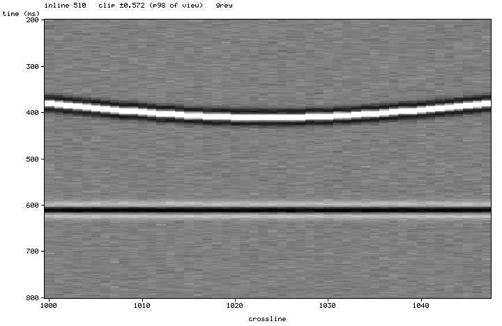
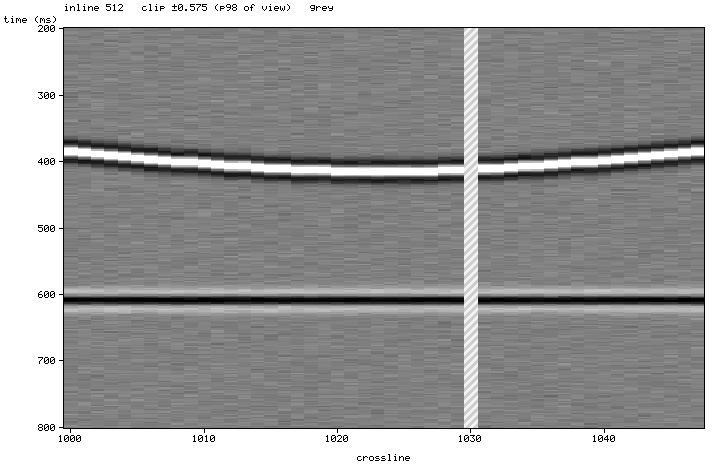
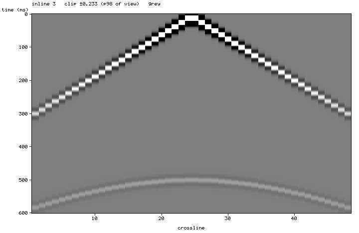

# Writing and editing SEG-Y

This example writes a SEG-Y file from numpy arrays and reads its headers back byte by byte to show that the geometry is where the standard puts it. It then converts the samples between formats and byte orders, edits headers and samples in place, and proves after each step which bytes changed and which did not. It ends with synthetic shot gathers written the way the sibling library geophysics writes them, and with the errors segyrs raises when a write or an edit would lose or corrupt data.

Everything on this page comes from one script, [`examples/write_and_edit.py`](https://github.com/cratongen/segyrs/blob/main/examples/write_and_edit.py). Run it from a checkout with `mise run example`. Each code block below is a verbatim part of that script, and each result block is verbatim output from it; `python/tests/test_examples.py` fails when either drifts. The script asserts every check the page describes, so a run that finishes is a run where they all held. It makes every array from a fixed seed or a closed-form expression, writes about 18 MB of scratch files, downloads nothing, and deletes its files at the end.

[Exploring a 3D volume](explore-3d-volume.md) covers opening, selecting and drawing. [Writing SEG-Y](../writing.md) is the full contract of the write path. This page applies both.

## Terms and conventions

A **SEG-Y** file is a 3200-byte **textual header**, a 400-byte **binary header**, then the **traces**. The textual header is 40 **cards** of 80 characters, usually in **EBCDIC**, the IBM mainframe character code, which Python calls `cp037`. The binary header describes every trace of the file: the **sample interval**, the number of **samples** per trace, and the **sample format code**, which says how each sample is stored. Each trace is a 240-byte **trace header** followed by its samples.

Three sample formats appear here. **IBM float** (code 1) is the hexadecimal floating-point format of IBM System/360 computers, still common in delivered data. **IEEE float** (code 5) is the 32-bit float of numpy's `float32`. **int16** (code 3) is a two-byte signed integer. The **byte order** says which byte of a multi-byte word comes first: **big-endian** (most significant first) is the SEG-Y default, **little-endian** is the order of most current computers.

A **scalar** is a header word that says how to turn a stored integer into a real value. The coordinate scalar **scalco** (bytes 71-72) applies to source, receiver and CDP coordinates, and the elevation scalar **scalel** (bytes 69-70) to elevations. A negative scalar divides the stored integer, a positive one multiplies it: with scalco -100 the integer 65032043 is 650 320.43 m.

| Convention | On this page |
| --- | --- |
| Dimension names | `inline`, `crossline`, `time` on a regular grid. The shot gathers use the same names for field record and channel ([below](#hand-off-to-geophysics)) |
| Time | Two-way time. Labels in **microseconds**, integers: `300_000` is 300 ms. The binary header stores the interval in microseconds, the delay word in milliseconds. Pictures label the axis in milliseconds |
| Label slices | Inclusive at both ends: `slice(510, 519)` keeps 10 inlines |
| Byte positions | 1-based, as the SEG-Y standard numbers them. Bytes 189-192 of a trace header are `header[188:192]` in Python. File bytes 3217-3218 are `raw[3216:3218]` |
| Byte order | Big-endian unless stated |
| Coordinates | Metres, stored as centimetres with `scalco` -100 |
| Amplitudes | Dimensionless model amplitudes |

## A volume from numpy arrays

The script builds a small post-stack volume, one trace per surface position, from a fixed seed. The grid has 32 inlines numbered 500 to 531 and 48 crosslines numbered 1000 to 1047. Each trace has 301 samples every 2 ms. The first sample is at 200 ms: that start time is the **delay recording time**, trace-header bytes 109-110, in milliseconds.

Two reflectors make the model: an anticline along the crosslines that dips 2 ms per inline, and a flat reflector with a negative **reflection coefficient** (the fraction of the wave amplitude reflected at an interface) that rises 1 ms per inline. Each coefficient is a spike at its time, convolved with a 30 Hz Ricker wavelet, with seeded noise of standard deviation 0.03 on top.

```python
rng = np.random.default_rng(20261120)
inlines = np.arange(500, 532)
crosslines = np.arange(1000, 1048)
n_samples, dt_us, delay_ms = 301, 2000, 200
t = delay_ms / 1000 + np.arange(n_samples) * dt_us / 1e6

il, xl = np.meshgrid(inlines, crosslines, indexing="ij")
horizons = [
    (0.36 + 0.0020 * (il - 500) + 0.03 * np.sin((xl - 1000) / 47 * np.pi), 1.0),
    (0.62 - 0.0010 * (il - 500), -0.6),
]
reflectivity = np.zeros((*il.shape, n_samples))
for twt, rc in horizons:
    k = np.rint((twt - t[0]) * 1e6 / dt_us).astype(int)
    np.put_along_axis(reflectivity, k[..., None], rc, axis=-1)
tw = np.arange(-25, 26) * dt_us / 1e6
ricker = (1 - 2 * (np.pi * 30 * tw) ** 2) * np.exp(-((np.pi * 30 * tw) ** 2))
cube = np.apply_along_axis(np.convolve, -1, reflectivity, ricker, mode="same")
cube = (cube + 0.03 * rng.standard_normal(cube.shape)).astype(np.float32)
print(cube.shape, cube.dtype)
```

```text
(32, 48, 301) float32
```

Each trace also gets the map position of its **common depth point** (CDP), the surface point that the stacked trace represents. Crossline numbers increase along a bearing of 20 degrees east of north, 12.5 m apart, and inline numbers increase at right angles to that, 25 m apart. The coordinates are rounded to centimetres, because the file stores them as integers with `scalco` -100 and a coordinate that the scalar cannot store exactly is refused ([below](#what-can-go-wrong)).

```python
azimuth = np.deg2rad(20)
along_il = 12.5 * (xl - 1000)
along_xl = 25.0 * (il - 500)
cdp_x = np.round(650_000 + along_il * np.sin(azimuth) + along_xl * np.cos(azimuth), 2)
cdp_y = np.round(7_800_000 + along_il * np.cos(azimuth) - along_xl * np.sin(azimuth), 2)
print(f"inline 500, crossline 1000: x {cdp_x[0, 0]:.2f} m, y {cdp_y[0, 0]:.2f} m")
print(f"inline 531, crossline 1047: x {cdp_x[-1, -1]:.2f} m, y {cdp_y[-1, -1]:.2f} m")
```

```text
inline 500, crossline 1000: x 650000.00 m, y 7800000.00 m
inline 531, crossline 1047: x 650929.20 m, y 7800287.00 m
```

`segyrs.create` takes an `(inline, crossline, time)` array and writes one trace per inline and crossline, crossline varying fastest. `sample_format` and `sample_interval_us` are required: segyrs does not choose a format for you. `inline` and `crossline` are the axis labels, written to bytes 189-192 and 193-196, the rev 1 positions for 3D post-stack data. `headers` adds any other trace-header field by name, one value per trace or one value for all; float coordinates are stored with the `scalco` given in the same mapping. `text` is the textual header, one card per line. Record there where the keys are and what the units are: it is the first thing the next person reads.

```python
path = workdir / "cube-ibm.sgy"
written = segyrs.create(
    path,
    cube,
    sample_format="ibm_float32",
    sample_interval_us=dt_us,
    inline=inlines,
    crossline=crosslines,
    headers={"cdp_x": cdp_x, "cdp_y": cdp_y, "scalco": -100, "delay": delay_ms},
    text=[
        "C 1 SYNTHETIC 3D POST-STACK VOLUME, SEED 20261120. NOT FIELD DATA.",
        "C 2 INLINE BYTES 189-192, CROSSLINE BYTES 193-196, BOTH INT32.",
        "C 3 CDP X BYTES 181-184, CDP Y BYTES 185-188, METRES, SCALCO -100.",
        "C 4 TWO-WAY TIME, 2 MS, 301 SAMPLES, FIRST SAMPLE AT 200 MS (BYTES 109-110).",
    ],
)
n_traces = len(inlines) * len(crosslines)
stride = 240 + 4 * n_samples
print(f"{written} bytes = 3600 + {n_traces} x (240 + {n_samples} x 4)")
assert written == path.stat().st_size == 3600 + n_traces * stride
```

```text
2221584 bytes = 3600 + 1536 x (240 + 301 x 4)
```

The file is the 3600 bytes of textual and binary header plus 1536 traces of a 240-byte header and 301 four-byte samples. `create` returns the number of bytes written. It writes to a temporary file and renames it at the end, so the path holds either the complete file or nothing.

## Check the headers against the bytes

A reader trusts the headers, so check them in the bytes rather than through the library that wrote them. `word` reads a big-endian signed integer at a 1-based byte position:

```python
raw = path.read_bytes()


def word(buf, byte, size):
    return int.from_bytes(buf[byte - 1 : byte - 1 + size], "big", signed=True)


print("bytes 3217-3218, sample interval (us):", word(raw, 3217, 2))
print("bytes 3221-3222, samples per trace:   ", word(raw, 3221, 2))
print("bytes 3225-3226, sample format code:  ", word(raw, 3225, 2))
print("bytes 3501-3502, revision:            ", raw[3500], raw[3501])
assert (word(raw, 3217, 2), word(raw, 3221, 2), word(raw, 3225, 2)) == (dt_us, n_samples, 1)
```

```text
bytes 3217-3218, sample interval (us): 2000
bytes 3221-3222, samples per trace:    301
bytes 3225-3226, sample format code:   1
bytes 3501-3502, revision:             1 0
```

The binary header holds the interval in microseconds (2000, so 2 ms), the sample count and format code 1, IBM float. Bytes 3501-3502 hold the revision as two single bytes, major then minor: this is a rev 1.0 file. `create` writes rev 1 unless the file needs a rev 2 feature, such as little-endian byte order or more than 65 535 samples.

Now one trace header. Traces are stored crossline fastest, so inline 510, crossline 1020 is trace (510 - 500) × 48 + 20 = 500, and its header starts at byte 3600 + 500 × 1444 of the file:

```python
k = (510 - 500) * len(crosslines) + (1020 - 1000)
header = raw[3600 + k * stride : 3600 + k * stride + 240]
inline, crossline = word(header, 189, 4), word(header, 193, 4)
scalco, x_word, y_word = word(header, 71, 2), word(header, 181, 4), word(header, 185, 4)
print(f"trace {k}: inline {inline}, crossline {crossline}, scalco {scalco}")
print(f"  cdp_x word {x_word} -> {x_word / -scalco} m, cdp_y word {y_word} -> {y_word / -scalco} m")
delay, ns, interval = word(header, 109, 2), word(header, 115, 2), word(header, 117, 2)
print(f"  delay {delay} ms, samples {ns}, interval {interval} us")
assert (inline, crossline) == (510, 1020)
assert (x_word / -scalco, y_word / -scalco) == (cdp_x[10, 20], cdp_y[10, 20])
```

```text
trace 500: inline 510, crossline 1020, scalco -100
  cdp_x word 65032043 -> 650320.43 m, cdp_y word 780014942 -> 7800149.42 m
  delay 200 ms, samples 301, interval 2000 us
```

The inline and crossline words hold the labels. The coordinate words hold centimetres: 65 032 043 with `scalco` -100 is 650 320.43 m, the value the script computed. `create` also writes the sample count (bytes 115-116) and the interval (bytes 117-118) into every trace header, because some programs read them there instead of in the binary header.

## Validate and read back

`segyrs.validate` checks the structure of the file without decoding samples: a known format code, whole textual blocks, a length that is the headers plus whole traces, and the sample count of every trace header. It returns the layout or raises `ValidationError` with every problem it found.

```python
print(segyrs.validate(path))
vol = segyrs.open(path)
print(vol)
print(vol.attrs["textual_encoding"], vol.attrs["textual_header"][3].rstrip())
```

```text
{'revision': '1', 'sample_format': 'ibm_float32', 'binary_format_code': 1, 'endian': 'big', 'n_traces': 1536, 'n_samples': 301, 'sample_interval_us': 2000, 'extended_textual_blocks': 0, 'extra_trace_header_blocks': 0, 'data_start': 3600}
<segyrs.Volume (inline: 32, crossline: 48, time: 301)> float32 ibm_float32, lazy, chunks of whole traces
  inline     500 .. 531
  crossline  1000 .. 1047
  time       200000 .. 800000 us
  geometry   inline_major
['ebcdic'] C 4 TWO-WAY TIME, 2 MS, 301 SAMPLES, FIRST SAMPLE AT 200 MS (BYTES 109-110).
```

IBM float has 24 fraction bits, but its exponent counts powers of 16, so the leading hexadecimal digit can hold up to three leading zero bits and only 21 bits are certain. A float32 written as IBM is rounded to the nearest IBM value, which changes it by at most 2^-21 of its own magnitude. The script checks every sample against that bound, and checks that the coordinates and the start time come back exactly:

```python
back = vol.numpy()
relative = np.abs(back - cube) / np.abs(cube)
print(f"largest relative change from float32 to IBM: {relative.max():.3g} (2^-21 = {2.0**-21:.3g})")
assert np.all(np.abs(back - cube) <= 2.0**-21 * np.abs(cube))
assert np.array_equal(vol.coords["cdp_x"], cdp_x) and np.array_equal(vol.coords["cdp_y"], cdp_y)
assert vol.coords["time"][0] == delay_ms * 1000
```

```text
largest relative change from float32 to IBM: 4.77e-07 (2^-21 = 4.77e-07)
```

The largest change equals the bound: a sample whose leading hexadecimal digit is 1 keeps 21 bits, against the 24 of a float32. Write IEEE float instead when the samples must come back bit for bit.

```python
pic = vol.sel(inline=510).plot(width=640, height=400)
pic.save(figures / "write-inline-510.png")
print(pic.text)
```

```text
segyrs section: inline 510 | x crossline (48 positions), y time (ms) (301 positions) | grid 48x301 | clip ±0.572 (p98 of drawn view) | grey
```



The picture comes from segyrs's own renderer. Without an explicit range it clips the amplitudes at the 98th percentile of the absolute values in the drawn view, and the text line says so.

## Convert sample formats

segyrs keeps the format of the file it reads. `to_segy` with no options copies the samples as they are, and a conversion happens only when you pass `sample_format=` or `endian=`.

**IBM to IEEE float.** Every IBM value in the float32 range decodes to a float32 exactly, so this conversion changes no sample value. The file size is the same, since both formats use four bytes per sample:

```python
ieee_path = workdir / "cube-ieee.sgy"
vol.to_segy(ieee_path, sample_format="ieee_float32")
ieee = segyrs.open(ieee_path)
print(ieee.attrs["sample_format"], ieee.attrs["binary_format_code"], ieee_path.stat().st_size)
assert np.array_equal(ieee.numpy(), back)
```

```text
ieee_float32 5 2221584
```

**And back to IBM.** The values that came from IBM fit IBM exactly, so converting back reproduces the original file. Compare the whole files, not only the samples, with a SHA-256 digest:

```python
def sha256(p):
    return hashlib.sha256(Path(p).read_bytes()).hexdigest()


ibm_again = workdir / "cube-ibm-again.sgy"
ieee.to_segy(ibm_again, sample_format="ibm_float32")
print("IBM -> IEEE -> IBM identical:", sha256(ibm_again) == sha256(path))
assert sha256(ibm_again) == sha256(path)
```

```text
IBM -> IEEE -> IBM identical: True
```

The digests match, so every header byte and every sample byte is as it was, including the format code that the round trip changed twice.

**To int16.** Integer formats take only whole numbers in range, and segyrs refuses to round or clip for you ([below](#what-can-go-wrong)). To store integers, choose the scale yourself, round, and write the counts. The script maps the largest absolute amplitude to 32 767, the largest int16:

```python
scale = 32767 / float(np.abs(back).max())
counts = np.round(back.astype(np.float64) * scale).astype(np.int16)
int_path = workdir / "cube-int16.sgy"
segyrs.create(
    int_path,
    counts,
    sample_format="int16",
    sample_interval_us=dt_us,
    inline=inlines,
    crossline=crosslines,
    headers={"cdp_x": cdp_x, "cdp_y": cdp_y, "scalco": -100, "delay": delay_ms},
)
restored = segyrs.open(int_path).numpy() / scale
error = np.abs(restored - back)
rms_amplitude = np.sqrt((back.astype(np.float64) ** 2).mean())
print(f"int16: {scale:.1f} counts per unit amplitude, {int_path.stat().st_size} bytes")
print(f"  largest error {error.max():.3g} = {error.max() * scale:.3f} counts")
print(f"  largest error / rms amplitude = {error.max() / rms_amplitude:.3g}")
assert error.max() <= 0.5 / scale * (1 + 1e-9)
```

```text
int16: 30005.0 counts per unit amplitude, 1296912 bytes
  largest error 1.67e-05 = 0.500 counts
  largest error / rms amplitude = 0.000109
```

The file is smaller, two bytes per sample instead of four. Rounding to the nearest count loses at most half a count, and the script asserts that bound on every sample: here the largest error is about one ten-thousandth of the RMS amplitude. The scale is not stored in any standard header word, so record it in the textual header or keep it beside the file; without it the counts have no amplitude unit.

**Byte order.** `endian="little"` reverses the bytes of every header word and every sample:

```python
lsb_path = workdir / "cube-lsb.sgy"
vol.to_segy(lsb_path, endian="little")
lsb = segyrs.open(lsb_path)
print(lsb.attrs["source_endian"], lsb.attrs["revision"], lsb.binary_header["byte_order_signature"])
assert np.array_equal(lsb.numpy(), back)
big_again = workdir / "cube-big-again.sgy"
lsb.to_segy(big_again, endian="big")
assert sha256(big_again) == sha256(path)
```

```text
little 1 0
```

The values are the same, and converting back to big-endian reproduces the original file. The little-endian copy keeps the revision of its source, rev 1, and rev 1 has no byte-order signature field (binary-header bytes 3297-3300 were added in rev 2), so the signature is 0. segyrs reports the order it found in `attrs["source_endian"]`, but rev 1 specifies big-endian, and a program that follows rev 1 strictly will misread this file. Keep big-endian for files you hand over unless the receiving program asks for little-endian.

## Edit in place

An in-place edit changes bytes inside the file and keeps its layout: the same sample format, sample count and number of traces. It is the way to correct headers on a large file without writing a second copy. A change of layout is a new file, written with `to_segy` or `create`.

### Find the bad trace

The script first damages one trace on purpose: it overwrites the trace at inline 512, crossline 1030 with its own samples plus spikes of ±25 every 7 samples, as a bad receiver or a corrupted record would. `write_traces` encodes the samples in the file's own format, IBM here. The **RMS** (root mean square) amplitude of each trace finds it:

```python
def loudest(volume):
    rms = volume.rms()
    i, j = np.unravel_index(rms.argmax(), rms.shape)
    print(f"trace RMS: median {np.median(rms):.3f}, largest {rms.max():.3f}", end=" ")
    print(f"at inline {inlines[i]}, crossline {crosslines[j]}")
    return inlines[i], crosslines[j]


loudest(vol)
bad = (512 - 500) * len(crosslines) + (1030 - 1000)
spikes = np.zeros(n_samples, np.float32)
spikes[::7] = rng.choice([-25.0, 25.0], size=len(spikes[::7]))
with segyrs.edit(path) as editor:
    editor.write_traces(back.reshape(n_traces, n_samples)[bad] + spikes, first=bad)
assert loudest(segyrs.open(path)) == (512, 1030)
```

```text
trace RMS: median 0.153, largest 0.159 at inline 507, crossline 1033
trace RMS: median 0.153, largest 9.436 at inline 512, crossline 1030
```

Before the damage the largest trace RMS was within 4% of the median. After it, one trace has an RMS about 60 times the median.

### Write the edits

The fix is four edits, done the way a processor would do them on a delivered file:

1. Replace card 6 of the textual header, bytes 401-480, with a note of what was done.
2. Set the measurement system in the binary header, bytes 3255-3256, to 1 (metres), since the coordinates are in metres and the file did not say so.
3. Write the CDP ensemble number (trace-header bytes 21-24) as a running count, and the **trace identification code** (bytes 29-30): 1 for seismic data, 2 for a **dead trace**, one that carries no data and that processing programs leave out.
4. Zero the samples of the bad trace.

```python
before = path.read_bytes()

opened = segyrs.open(path)
cards = bytearray(opened.textual_header_bytes[0])
card = "C 6 TRACE AT INLINE 512 CROSSLINE 1030 KILLED (SPIKES), TRACE ID 2."
cards[400:480] = card.ljust(80).encode("cp037")
binary = bytearray(opened.binary_header_bytes)
binary[54:56] = (1).to_bytes(2, "big")
trace_id = np.ones(n_traces, np.int64)
trace_id[bad] = 2

with segyrs.edit(path) as editor:
    editor.write_textual_block(0, bytes(cards))
    editor.write_binary_header(bytes(binary))
    editor.set_headers({"cdp": np.arange(1, n_traces + 1), "trace_id": trace_id})
    editor.write_traces(np.zeros(n_samples, np.float32), first=bad)
```

In Python the blocks are 0-based: card 6 is `cards[400:480]`, and file bytes 3255-3256 are `binary[54:56]` of the 400-byte binary header. Each editor call checks all of its input before it writes a byte, so an error leaves the file as it was ([below](#what-can-go-wrong)). Leaving the `with` block flushes the edits to disk once.

### Prove what changed

Compare the file before and after, byte by byte, and sort every changed byte into the part of the file it belongs to:

```python
after = path.read_bytes()
assert len(after) == len(before)
changed = np.flatnonzero(np.frombuffer(before, np.uint8) != np.frombuffer(after, np.uint8))
in_text = changed[changed < 3200]
in_binary = changed[(changed >= 3200) & (changed < 3600)]
offset_in_trace = (changed[changed >= 3600] - 3600) % stride
trace_of = (changed[changed >= 3600] - 3600) // stride
header_bytes = np.unique(offset_in_trace[offset_in_trace < 240] + 1)
sample_traces = np.unique(trace_of[offset_in_trace >= 240])
print("changed bytes:", len(changed))
print("  textual cards:", np.unique(in_text // 80 + 1))
print("  binary-header bytes:", in_binary + 1)
print("  trace-header bytes:", header_bytes)
print("  traces with changed samples:", sample_traces)
assert set(np.unique(in_text // 80 + 1)) == {6}
assert set(in_binary + 1) <= {3255, 3256}
assert set(header_bytes) <= {21, 22, 23, 24, 29, 30}
assert list(sample_traces) == [bad]
```

```text
changed bytes: 5605
  textual cards: [6]
  binary-header bytes: [3256]
  trace-header bytes: [23 24 30]
  traces with changed samples: [606]
```

The file has the same length. The changes sit in card 6, in byte 3256 (the low byte of the measurement system; the high byte was already 0), in bytes 23-24 and 30 of the trace headers, and in the samples of trace 606 and of no other trace. Bytes 21-22 and 29 did not change because the new values (CDP numbers up to 1536, codes 1 and 2) have zero high bytes, as the old zeros did. The assertions allow exactly the edited words and nothing else, so a write to a wrong position would fail the script.

Read the edits back. `dead_trace="trace_id"` tells `open` to mark traces whose code is 2 as dead:

```python
edited = segyrs.open(path, dead_trace="trace_id")
print(segyrs.validate(path)["n_traces"], "traces,", edited.attrs["measurement_system"])
print(edited.attrs["textual_header"][5].rstrip())
dead = np.flatnonzero(~edited.coords["trace_mask"].ravel())
print("dead traces:", dead, " cdp:", edited.headers["cdp"][dead])
assert list(dead) == [bad]
untouched = np.delete(edited.numpy().reshape(n_traces, n_samples), bad, axis=0)
assert np.array_equal(untouched, np.delete(back.reshape(n_traces, n_samples), bad, axis=0))
assert np.all(edited.numpy()[12, 30] == 0)
```

```text
1536 traces, meters
C 6 TRACE AT INLINE 512 CROSSLINE 1030 KILLED (SPIKES), TRACE ID 2.
dead traces: [606]  cdp: [607]
```

Every other trace holds the samples the script first wrote, bit for bit.

```python
pic = edited.sel(inline=512).plot(width=640, height=400)
pic.save(figures / "write-inline-512-killed.png")
print(pic.text)
```

```text
segyrs section: inline 512 | x crossline (48 positions), y time (ms) (301 positions) | grid 48x301 | clip ±0.575 (p98 of drawn view) | grey
```



The picture hatches the dead trace and leaves it out of the clip percentile.

## Round trips

**A copy with no options is the same file.** `to_segy` on the opened volume copies the textual, binary and trace headers and the samples without decoding them:

```python
copy_path = workdir / "copy.sgy"
edited.to_segy(copy_path)
print("unchanged copy identical:", sha256(copy_path) == sha256(path))
assert sha256(copy_path) == sha256(path)
```

```text
unchanged copy identical: True
```

**A crop keeps what it keeps.** A selection writes only its traces and its sample window. The script keeps inlines 510 to 519 and the window from 300 to 500 ms:

```python
crop_path = workdir / "crop.sgy"
edited.sel(inline=slice(510, 519), time=slice(300_000, 500_000)).to_segy(crop_path)
crop = segyrs.open(crop_path)
print(crop)
expected = back[10:20, :, 50:151].copy()
expected[2, 30] = 0
assert np.array_equal(crop.numpy(), expected)
assert np.array_equal(crop.coords["cdp_x"], cdp_x[10:20])
assert np.array_equal(crop.headers["cdp"], edited.headers["cdp"][10 * 48 : 20 * 48])
assert crop.coords["time"][0] == 300_000
```

```text
<segyrs.Volume (inline: 10, crossline: 48, time: 101)> float32 ibm_float32, lazy, chunks of whole traces
  inline     510 .. 519
  crossline  1000 .. 1047
  time       300000 .. 500000 us
  geometry   inline_major
```

The crop holds the same samples as the source at those positions, including the zeroed trace, and the same coordinates and CDP numbers. Its delay word moved from 200 to 300 ms, so each kept sample keeps its time. The window has 101 samples because label slices include both ends.

## Hand-off to geophysics

geophysics is the sibling library for forward geophysical modelling. It writes its synthetic seismic records to SEG-Y through segyrs. This section does not import it: it builds the same kind of record in numpy and writes it with the trace-header layout that geophysics uses for gathers, so you can see what such a file holds and how to open it.

A **shot gather**, or **field record**, holds the traces that receivers recorded from one source firing, one trace per receiver **channel**. Here five shots, 200 m apart, are each recorded by 48 receivers in a **split spread**: 24 receivers on each side of the source, 25 m apart, with a 50 m gap at the source. The **offset** is signed, receiver x minus source x, so it is negative on the side where x decreases (the SEG-Y convention when the line is shot towards increasing x).

The earth is one layer with a velocity of 2000 m/s over a flat reflector at 500 m depth. The **direct wave** travels along the surface and arrives at `|offset| / v`. The **reflection** arrives at `sqrt((2 × depth / v)² + (offset / v)²)`. Each arrival is a spike scaled by `1 / distance` travelled, the spreading of a wave from a point source, convolved with a 30 Hz Ricker wavelet sampled every 1 ms. No noise is added, so every arrival time is known exactly.

```python
n_shots, n_channels, shot_n, shot_dt_us = 5, 48, 601, 1000
v, depth = 2000.0, 500.0
shot_x = 1000.0 + 200.0 * np.arange(n_shots)
offset = np.tile(np.r_[-25 * np.arange(24, 0, -1), 25 * np.arange(1, 25)], (n_shots, 1))
receiver_x = shot_x[:, None] + offset
direct = np.abs(offset) / v
reflected = np.sqrt((2 * depth / v) ** 2 + (offset / v) ** 2)
print("signed offsets of shot 0:", offset[0, :3], "...", offset[0, -3:])

gathers = np.zeros((n_shots, n_channels, shot_n))
for arrival, distance, amplitude in [
    (direct, np.abs(offset), 1.0),
    (reflected, v * reflected, 0.6),
]:
    k = np.rint(arrival * 1e6 / shot_dt_us).astype(int)
    np.put_along_axis(gathers, k[..., None], (amplitude * 100 / distance)[..., None], axis=-1)
stw = np.arange(-40, 41) * shot_dt_us / 1e6
wavelet = (1 - 2 * (np.pi * 30 * stw) ** 2) * np.exp(-((np.pi * 30 * stw) ** 2))
gathers = np.apply_along_axis(np.convolve, -1, gathers, wavelet, mode="same").astype(np.float32)
```

```text
signed offsets of shot 0: [-600 -575 -550] ... [550 575 600]
```

The headers follow the geophysics layout: trace sequence numbers (bytes 1-4 and 5-8), the field record (9-12) and the channel (13-16), the source point (17-20), trace identification code 11 (a seismic pressure sensor, the trace type of an acoustic simulation), the signed offset (37-40), elevations with `scalel`, source and receiver coordinates with `scalco`, coordinate units 1 (length, bytes 89-90), the delay, the midpoint as the CDP coordinate, and the field record and channel again at bytes 189 and 193. The samples are IEEE float, so they are stored exactly. `create` does not set the binary-header measurement system, so the script sets it to metres with an in-place edit, as in the [edit section](#write-the-edits):

```python
record = np.repeat(np.arange(1, n_shots + 1), n_channels)
channel = np.tile(np.arange(1, n_channels + 1), n_shots)
sequence = np.arange(1, n_shots * n_channels + 1)
shot_path = workdir / "shots.sgy"
segyrs.create(
    shot_path,
    gathers.reshape(-1, shot_n),
    sample_format="ieee_float32",
    sample_interval_us=shot_dt_us,
    headers={
        "trace_seq_line": sequence,
        "trace_seq_file": sequence,
        "field_record": record,
        "trace_in_record": channel,
        "source_point": record,
        "trace_id": 11,
        "offset": offset.ravel(),
        "group_elev": 0.0,
        "source_elev": 0.0,
        "scalel": -100,
        "scalco": -100,
        "source_x": np.repeat(shot_x, n_channels),
        "source_y": 0.0,
        "group_x": receiver_x.ravel(),
        "group_y": 0.0,
        "coord_units": 1,
        "delay": 0,
        "cdp_x": ((np.repeat(shot_x, n_channels) + receiver_x.ravel()) / 2),
        "cdp_y": 0.0,
        "inline": record,
        "crossline": channel,
    },
    text=[
        "C 1 SYNTHETIC 2D SHOT GATHERS, ANALYTIC ARRIVALS, NO NOISE. NOT FIELD DATA.",
        "C 2 FIELD RECORD BYTES 9-12, CHANNEL BYTES 13-16, SIGNED OFFSET BYTES 37-40.",
        "C 3 ONE LAYER, V 2000 M/S, FLAT REFLECTOR AT 500 M. TRACE ID 11 (PRESSURE).",
        "C 4 COORDINATES IN METRES, SCALCO AND SCALEL -100. 1 MS, 601 SAMPLES.",
    ],
)
binary = bytearray(segyrs.open(shot_path).binary_header_bytes)
binary[54:56] = (1).to_bytes(2, "big")
with segyrs.edit(shot_path) as editor:
    editor.write_binary_header(bytes(binary))
```

A shot file has no inlines or crosslines, but it is still a regular grid: every field record has the same 48 channels. Point segyrs's two grid keys at the field record and the channel with `inline_byte=9` and `crossline_byte=13`. The dimensions keep segyrs's names, `inline` and `crossline`, whatever bytes they come from:

```python
shots = segyrs.open(shot_path, inline_byte=9, crossline_byte=13)
print(shots)
print(shots.geometry)
assert np.array_equal(shots.numpy(), gathers)
sx, gx = shots.coords["source_x"], shots.coords["group_x"]
assert np.array_equal(gx - sx, shots.coords["offset"])
```

```text
<segyrs.Volume (inline: 5, crossline: 48, time: 601)> float32 ieee_float32, lazy, chunks of whole traces
  inline     1 .. 5
  crossline  1 .. 48
  time       0 .. 600000 us
  geometry   inline_major
Geometry(kind='inline_major', axes=('inline', 'crossline'), inlines=5, crosslines=48, offsets=48, bytes=(inline=9, crossline=13, offset=37))
```

The report finds 5 records of 48 channels and 48 distinct offsets. Each record and channel holds one trace, so `offset` is a coordinate along the grid, not a third dimension. The samples equal the arrays the script wrote, and the receiver minus source coordinates equal the offset word on every trace.

The arrival times are the check that the samples, the offsets and the sample interval agree. For shot 3, the script picks the largest absolute amplitude within 10 ms of each predicted arrival:

```python
gather = shots.sel(inline=3).numpy()
for name, arrival in [("direct", direct[2]), ("reflection", reflected[2])]:
    picked = []
    for trace, when in zip(gather, arrival, strict=True):
        centre = round(when * 1e6 / shot_dt_us)
        window = trace[centre - 10 : centre + 11]
        picked.append((centre - 10 + int(np.argmax(np.abs(window)))) * shot_dt_us / 1000)
    worst = np.abs(np.array(picked) - arrival * 1000).max()
    print(f"shot 3 {name}: largest pick error {worst:.2f} ms")
    assert worst <= shot_dt_us / 1000
```

```text
shot 3 direct: largest pick error 0.50 ms
shot 3 reflection: largest pick error 0.50 ms
```

Both events are within half a sample of the exact time, the best a pick on a 1 ms grid can do; many arrival times fall halfway between two samples.

```python
pic = shots.sel(inline=3).plot(width=640, height=400)
pic.save(figures / "shot-3.png")
print(pic.text)
```

```text
segyrs section: inline 3 | x crossline (48 positions), y time (ms) (601 positions) | grid 48x400 | clip ±0.233 (p98 of drawn view) | grey
```



The horizontal axis is the channel and the picture names it `crossline`, the dimension it fills. The direct wave is the V, the reflection the hyperbola below it. The reflection is weaker because it travels at least 1000 m against 25 to 600 m for the direct wave.

## What can go wrong

Every message below is the real one, printed by the script through these helpers. `attempt_create` writes the cube with one argument changed:

```python
def show_error(call):
    try:
        call()
    except Exception as err:
        print(f"{type(err).__name__}: {err}")
    else:
        raise AssertionError("expected an error")


def attempt_create(**changes):
    options = dict(
        sample_format="ibm_float32", sample_interval_us=dt_us, inline=inlines, crossline=crosslines
    )
    options.update(changes)
    data = options.pop("data", cube)
    segyrs.create(workdir / "refused.sgy", data, **options)
```

Each class is a subclass of `segyrs.SegyrsError` except the first, a plain `ValueError`; the [user guide](../user-guide.md#errors) lists them all. In every case of this section nothing is written: the script asserts that the refused file does not exist and that the edited file is byte for byte what it was.

**A sample interval that is not a whole number of microseconds.** The binary header stores the interval as an integer. An interval of 1/3 ms would be stored as 333 µs, and the time of every sample would be short by 0.1% of its time since the first sample, so segyrs refuses:

```python
show_error(lambda: attempt_create(sample_interval_us=1000 / 3))
```

```text
ValueError: sample_interval_us=333.3333333333333 is not a whole number of microseconds; the binary header stores the interval as an integer
```

**A coordinate the scalar cannot store.** With `scalco` -100 a coordinate is stored in centimetres. 650 000.001 m would be 65 000 000.1 cm, which is not an integer. Round the coordinates to the scalar's precision first, or use a finer scalar:

```python
show_error(lambda: attempt_create(headers={"cdp_x": cdp_x + 0.001, "scalco": -100}))
```

```text
HeaderValueError: header field cdp_x (byte 181): value 650000.001 (scalar -100 gives 65000000.1, not a whole number; use a finer scalar) does not fit int32
```

**A scalar too fine for the word.** A finer scalar is not free: with `scalco` -10000 the x coordinate is 6 500 000 000 tenths of a millimetre, which does not fit the 32-bit word. Here the y coordinates, near 7.8 million metres, fit only with `scalco` -100 or coarser:

```python
show_error(lambda: attempt_create(headers={"cdp_x": cdp_x, "scalco": -10000}))
```

```text
HeaderValueError: header field cdp_x (byte 181): value 6500000000 does not fit int32
```

**NaN in IBM float.** IBM float has no NaN pattern. Replace NaN with a value, or with 0 and a dead-trace code, before writing IBM. IEEE float stores NaN:

```python
with_nan = cube.copy()
with_nan[3, 4, 100] = np.nan
show_error(lambda: attempt_create(data=with_nan))
```

```text
SampleValueError: trace 148 sample 100: value NaN is not representable as ibm_float32
```

The error names the first failing sample in file order: trace 148 is inline 503, crossline 1004, the position the script set.

**A conversion to integers.** The amplitudes are fractions, so int16 cannot hold them. Scale and round them yourself, as [above](#convert-sample-formats):

```python
show_error(lambda: vol.to_segy(workdir / "refused.sgy", sample_format="int16"))
```

```text
SampleValueError: trace 0 sample 0: value 0.04146533 is not representable as int16
```

**Edits that would break the file.** A trace one sample short, a write that runs past the last trace, a delay that does not fit its 16-bit word, and a binary header that changes the sample format. The last one would make the editor read every existing trace with the wrong format, which is why a format change is a new file:

```python
snapshot = path.read_bytes()
with segyrs.edit(path) as editor:
    show_error(lambda: editor.write_traces(np.zeros(n_samples - 1, np.float32), first=0))
    two_traces = np.zeros((2, n_samples), np.float32)
    show_error(lambda: editor.write_traces(two_traces, first=n_traces - 1))
    show_error(lambda: editor.set_header("delay", 40_000))
    changed_format = bytearray(snapshot[3200:3600])
    changed_format[24:26] = (5).to_bytes(2, "big")
    show_error(lambda: editor.write_binary_header(bytes(changed_format)))
assert path.read_bytes() == snapshot
```

```text
TraceLengthError: samples have 300 columns, the file has 301 samples per trace
SpecError: invalid write request: trace 1536 is outside 0..1536
HeaderValueError: header field delay (byte 109): value 40000 does not fit int16
FormatChangeError: format change is a new file
```

The file is unchanged after all four.

**A file with extra bytes.** A copy or a transfer can leave bytes after the last trace. `validate` reports the file length, the length the headers predict, and the difference:

```python
padded = workdir / "padded.sgy"
shutil.copyfile(path, padded)
with open(padded, "ab") as f:
    f.write(bytes(100))
show_error(lambda: segyrs.validate(padded))
```

```text
ValidationError: invalid SEG-Y: sample count mismatch: file_len=2221684 expected=2221584 remainder=100
```

`segyrs.open` raises `SampleCountMismatch` with the same numbers. [Exploring a 3D volume](explore-3d-volume.md#what-can-go-wrong) shows how to cut a copy to the expected length when you know the extra bytes are padding.
